# ランタイムアーキテクチャ

## 目的

この文書は、IdMagic を構成するプロセスと、その間の通信を示す。

## 実行単位

| 実行単位 | 入口 | 責務 | 状態 |
| --- | --- | --- | --- |
| API | `backend/cmd/idmagic` | OAuth2/OIDC、管理、アカウント、SCIM、Shared Signals などの HTTP リクエストを処理する | 正となる業務状態をプロセス内に保持しない |
| Worker | `backend/cmd/idmagic-worker` | キューに記録された遅延・再試行可能なジョブを処理する | PostgreSQL のジョブ状態を取得して確定する |
| Batch | `backend/cmd/idmagic-batch` | 保持期限に基づく削除など、横断的な保守処理を実行する | PostgreSQL の対象状態を更新する |
| Seed | `backend/cmd/idmagic-seed` | 初期データを投入する一回限りの管理実行単位 | PostgreSQL に結果を確定する |
| フロントエンドゲートウェイ | `frontend` | ブラウザー向け画面と同一オリジンの API 中継を提供する | ブラウザーセッション以外の正となる業務状態を保存しない |
| Directory Connector | `backend/cmd/idmagic-directory-connector` | 利用者の閉域で AD または OpenLDAP を読み、差分を Connector API へ送る | 秘密鍵、登録の情報、差分の位置を手元の状態のディレクトリに置く。IdMagic のデータベースに接続しない |
| MCP Gateway | `backend/cmd/idmagic-mcp-gateway` | 既存の MCP サーバーの手前で要求を解釈し、IdMagic の評価が許可した要求だけを転送する | 状態を持たない。IdMagic のデータベースに接続しない |

API は複数のモジュールを一つのプロセスに組み立てる。
Directory Connector は IdMagic の運用者ではなく利用者が配置し、仕様は [Directory Connector の実行環境](../../modules/directory-connector/features/runtime.md)が定める。
MCP Gateway も利用者が配置し、仕様は [MCP Gateway の実行環境](../../modules/mcp-gateway/features/runtime.md)が定める。
Worker と Batch は、長時間処理や再試行を HTTP リクエストから分離する。

## 実行単位が実装する機能

この節は、各実行単位が実装する機能の一覧と、詳細を定める文書を示す。
機能の振る舞いは所有するモジュールの文書が定め、ここには種類と参照先だけを置く。

### API

API は、API リファレンスに載るすべてのエンドポイントを、[API ガイドライン](../application/api-guidelines.md)に従って実装する。
API リファレンスは `spec/` の TypeSpec から生成し、`mise run build-site` で生成する文書サイトの「API リファレンス」で読む。
各エンドポイントの振る舞いは、TypeSpec の操作が属するモジュールの[シナリオ](../../modules/README.md)が定める。

### Worker

Worker は、ジョブのハンドラーと、プロセス内で周期的に動く処理の二種類を実行する。
ハンドラーは、Worker の入口（`backend/cmd/idmagic-worker`）で `JobKind` ごとに登録する。
ジョブの取得、再試行、レーン、配信不能の扱いは [Jobs](../../modules/jobs/README.md) が定める。

| `JobKind` | 投入するモジュール | 処理 | 詳細 |
| --- | --- | --- | --- |
| `user_import_preview`、`user_import_apply` | IdManagement | 利用者の CSV インポートを検証し、確定する | [CSV の転送の実現方式](../../modules/identity-management/features/csv-transfer.md#実現方式) |
| `group_import_preview`、`group_import_apply` | IdManagement | グループの CSV インポートを検証し、確定する | [グループ CSV の設計](../../modules/identity-management/features/group-csv.md#実現方式) |
| `group_membership_import_preview`、`group_membership_import_apply` | IdManagement | グループメンバーシップの CSV インポートを検証し、確定する | [グループ CSV の設計](../../modules/identity-management/features/group-csv.md#実現方式) |
| `dynamic_group_reconcile` | IdManagement | 動的グループの規則を評価し、メンバーシップを収束させる | [動的グループ](../../modules/identity-management/features/dynamic-group.md) |
| `data_export` | IdManagement | 管理者が要求した CSV データエクスポートを作る | [データエクスポートの設計](../../modules/identity-management/features/data-export.md#実現方式) |
| `audit_export` | Audit | bulk レーンで監査の検索結果を JSON 成果物へ生成する | [監査エクスポート](../../modules/audit/features/event-export.md) |
| `data_key_reencryption` | DataKeys | DEK のローテーション後に、各モジュールの秘密情報を新しいバージョンの DEK で再暗号化する | [DEK のライフサイクルの設計](../../modules/data-keys/features/lifecycle.md#実現方式) |
| `lifecycle_workflow_run` | IdGovernance | ライフサイクルワークフローを一回実行する | [IdGovernance](../../modules/identity-governance/README.md) |
| `provisioning_task` | Provisioning | 連携先のアプリケーションへ利用者とグループの変更を反映する | [Provisioning の内部設計](../../modules/provisioning/features/synchronization.md#実現方式) |
| `backchannel_logout_delivery` | OAuth2 | OpenID Connect Back-Channel Logout の通知をクライアントへ送る | [ログアウト](../../modules/oauth2/features/logout.md) |
| `noop_echo` | Jobs | 入力をそのまま返す。Worker の起動と配線を確かめるためのジョブである | [永続キュー](../../modules/jobs/features/queue.md) |

周期的な処理は、ジョブのキューを通らずに Worker のプロセス内で動く。

| 処理 | 内容 | 詳細 |
| --- | --- | --- |
| ライフサイクルワークフローのディスパッチ | ジョブへ関連付けられていないワークフロー実行を探し、`lifecycle_workflow_run` のジョブを投入する | [IdGovernance](../../modules/identity-governance/README.md) |
| プロビジョニングのディスパッチ | 保留中のプロビジョニングタスクを `provisioning_task` のジョブへ関連付ける | [Provisioning の内部設計](../../modules/provisioning/features/synchronization.md#実現方式) |
| プロビジョニングの照合 | イベント同期が作らなかった差分を探し、プロビジョニングタスクにする | [Provisioning の内部設計](../../modules/provisioning/features/synchronization.md#実現方式) |
| 短命な状態の掃除 | 認可リクエスト、認可コード、デバイスコード、リプレイ防止、WebAuthn のセッション、流量制御など、期限を過ぎた短命な状態のレコードを削除して領域を回収する。有効期限は読み取り時に判定するので、掃除が遅れても期限は延びない | [データのライフサイクル](../data/lifecycle.md) |
| セキュリティイベントの配信 | Shared Signals の送信ストリームへ、配信期限が来たセキュリティイベントを送り、再試行と配信不能を管理する | [SharedSignals の状態遷移](../../modules/sharedsignals/features/stream.md#状態遷移) |
| キューの滞留数の記録 | レーンごとの待機中と実行中のジョブ数をメトリクスへ記録する | [監視設計](../observability/monitoring.md) |

### Batch

Batch は、`idmagic-batch <サブコマンド>` として一回ずつ起動する保守処理である。
定期実行の間隔は `infra/k8s/base/batch-cronjobs.yaml` の CronJob が一次情報である。

| サブコマンド | 処理 | 実行の契機 | 詳細 |
| --- | --- | --- | --- |
| `retention-sweep` | 保持期間を過ぎた記録と成果物の削除、削除予約の User の完全削除、User の使用量の再集計、Soft Quota の使用量の照合と警告 | CronJob（毎時） | [データのライフサイクル](../data/lifecycle.md)、[Soft Quota の照合](../../modules/tenancy/features/quota.md#req-tenancy-048-soft-quota-の照合は実データの使用量を保存し超過を警告する) |
| `signing-key-lifecycle` | 署名鍵の世代交代と、JWKS に古い鍵を残す猶予期間を管理する | CronJob（毎日） | [SigningKeys](../../modules/signing-keys/README.md) |
| `data-key-lifecycle` | 周期を過ぎたテナントの DEK をローテーションし、それ以外のテナントの未移行の行に再暗号化のジョブを投入する | CronJob（毎日） | [DEK のライフサイクル](../../modules/data-keys/features/lifecycle.md) |
| `data-key-reencryption-sweep` | テナントと再暗号化の対象ごとに `data_key_reencryption` のジョブを投入する | 運用者が手で起動する。CronJob は宣言していない | [シークレット管理](../security/secrets.md) |
| `restore-consistency-check` | バックアップから復元したデータベースの件数、署名鍵、ジョブの重複を検査する | 復元手順の最後 | [バックアップ、復元、災害復旧の運用手順書](../../runbooks/backup-restore-dr.md) |

### Seed

Seed は、環境ごとの初期データを宣言したマニフェストを読み、計画して適用する。
`--mode dry_run` は計画だけを返し、`--mode apply` は各モジュールが公開するコマンドを呼んで適用する。
開発環境では `mise run seed -- <環境> <プロファイル>` で、Kubernetes では Job として起動する。

投入する初期データは、プロファイルごとに `seed/manifests/<プロファイル>.yaml` のマニフェストが宣言する。

| プロファイル | 投入する初期データ | 許される環境 |
| --- | --- | --- |
| `bootstrap` | 管理コンソールとマイページが使うファーストパーティーの OAuth クライアント | すべての環境。本番で許されるのはこのプロファイルだけである |
| `development` | `bootstrap` の内容に加え、デモ用の利用者（`alice`、`root`）、グループ、WS-Federation と SAML のデモ用アプリケーション | 本番以外 |
| `test` | `development` と同じ内容 | `test` 環境だけ |
| `performance` | `bootstrap` の内容に加え、負荷試験に使う大量の利用者。件数は `--count` で与える | 本番以外 |

マニフェストの文法、シークレットの参照、環境ごとの制限は [Seeding](../../modules/seeding/README.md) が定める。

### フロントエンドゲートウェイ

フロントエンドゲートウェイが配信する画面は、ログインと認証フロー、マイページ、管理コンソール、システム管理の四つに分かれる。
画面の一覧は[フロントエンド設計](../application/frontend.md#画面の一覧)が示す。

## 通信

次の Container 図は、デプロイ先に依存しないサーバー側と利用者側の実行単位と通信を示す。
Container は Docker のコンテナではなく、個別に起動する実行単位を指す。
エッジでの TLS 終端、スケジューラー、スキーマ適用、初期投入の起動順は、[デプロイメントアーキテクチャの共通トポロジー](deployment.md#共通トポロジー)が扱う。
Directory Connector と MCP Gateway は利用者が配置し、IdMagic の公開 HTTP エンドポイントを呼び出す。
MCP クライアントとの TLS 接続は利用者側の前段で終端し、MCP サーバーには MCP Gateway からだけ到達できるようにする。
利用者の Envoy を執行の位置にする構成では、MCP Gateway は `ext_authz` の判定だけを返し、MCP サーバーへは Envoy からだけ到達できるようにする。
MCP Gateway に下流の設定があれば、許可した呼び出しごとに IdMagic のトークンエンドポイントで下流宛のトークンを得て、自身の鍵で束縛して MCP サーバーへ渡す。
各 CLI の通信の詳細は、それぞれの実行環境の文書が定める。

```mermaid
---
config:
  c4:
    width: 230
    c4ShapeMargin: 110
    diagramMarginX: 30
    diagramMarginY: 30
---
C4Container
  System_Ext(directory, "AD または OpenLDAP", "利用者の閉域のディレクトリ")
  System_Ext(mcpserver, "保護対象の MCP サーバー", "MCP Gateway からだけ到達")
  System_Ext(mcpclient, "MCP クライアント", "トークンを取得して MCP を利用")
  Container(connector, "Directory Connector", "Go", "利用者の閉域に配置<br/>秘密鍵と差分の位置を手元に保持")
  Container_Ext(mcptls, "MCP の TLS 終端", "リバースプロキシ", "利用者が配置")
  Container(mcpgateway, "MCP Gateway", "Go", "利用者が配置<br/>IdMagic の評価結果で要求を執行")
  Person(browser, "利用者と管理者", "ブラウザーから利用")
  Container(front, "フロントエンドゲートウェイ", "idmagic-frontend", "静的アセットの配信と API 中継")
  System_Ext(apps, "連携アプリケーション", "OAuth、OIDC、SAML、SCIM のクライアント")
  System_Ext(upstream, "上流の IdP", "OIDC プロバイダーと SAML IdP")
  Container(api, "API", "idmagic-api", "公開 HTTP エンドポイントの処理")
  System_Ext(downstream, "下流の送信先", "SCIM サーバー、SSF の受信側、SMTP サーバー")
  Container(w1, "Worker：latency_sensitive", "idmagic-worker", "短い待ち時間を求めるジョブ")
  ContainerDb(pg, "PostgreSQL", "PostgreSQL", "業務データ、短命状態、ジョブ")
  Container(w2, "Worker：default", "idmagic-worker", "通常のジョブ")
  Container(batch, "Batch", "idmagic-batch", "保守処理を一回実行")
  Container(w3, "Worker：bulk", "idmagic-worker", "大量処理のジョブ")
  Container(seed, "Seed", "idmagic-seed", "初期データを一回投入")
  Rel(connector, directory, "属性と差分を読み取る", "LDAPS または StartTLS")
  Rel(connector, front, "登録、接続報告、差分の送信", "HTTPS：Connector API")
  Rel(mcpclient, front, "認可とトークン取得", "HTTPS：OAuth")
  Rel(mcpclient, mcptls, "MCP の要求", "HTTPS：Streamable HTTP")
  Rel(mcptls, mcpgateway, "TLS 終端後の要求を中継", "HTTP")
  Rel(mcpgateway, front, "要求ごとにリソースアクセスを評価", "HTTPS")
  Rel(mcpgateway, mcpserver, "許可した要求だけを転送", "Streamable HTTP")
  Rel(browser, front, "画面と API を使う", "HTTP")
  Rel(apps, front, "公開 API を使う", "HTTP")
  Rel(front, api, "API の経路だけを中継", "HTTP")
  BiRel(api, upstream, "メタデータ、トークン<br/>公開鍵", "HTTP")
  Rel(api, downstream, "プロビジョニング<br/>イベントとメールを送信")
  Rel(api, pg, "状態を読み書き")
  Rel(w1, pg, "ジョブを取得し確定")
  Rel(w2, pg, "ジョブを取得し確定")
  Rel(w3, pg, "ジョブを取得し確定")
  Rel(batch, pg, "保守対象を更新")
  Rel(seed, pg, "初期データを保存")
  Rel(w1, downstream, "送信")
  Rel(w2, downstream, "送信")
  Rel(w3, downstream, "送信")
  UpdateRelStyle(connector, directory, $offsetX="15")
  UpdateRelStyle(connector, front, $offsetX="-40", $offsetY="-60")
  UpdateRelStyle(mcpclient, front, $offsetX="-240", $offsetY="160")
  UpdateRelStyle(mcpclient, mcptls, $offsetX="50", $offsetY="-60")
  UpdateRelStyle(mcptls, mcpgateway, $offsetX="-180", $offsetY="65")
  UpdateRelStyle(mcpgateway, front, $offsetX="35", $offsetY="10")
  UpdateRelStyle(mcpgateway, mcpserver, $offsetX="-140", $offsetY="-10")
  UpdateRelStyle(browser, front, $offsetY="-25")
  UpdateRelStyle(apps, front, $offsetY="-25")
  UpdateRelStyle(front, api, $offsetX="15")
  UpdateRelStyle(api, upstream, $offsetX="-80", $offsetY="-60")
  UpdateRelStyle(api, downstream, $offsetX="-60", $offsetY="-60")
  UpdateRelStyle(api, pg, $offsetX="15")
  UpdateRelStyle(w1, pg, $offsetY="-25")
  UpdateRelStyle(w2, pg, $offsetY="-25")
  UpdateRelStyle(w3, pg, $offsetX="15")
  UpdateRelStyle(batch, pg, $offsetX="-65")
  UpdateRelStyle(seed, pg, $offsetX="30")
  UpdateRelStyle(w1, downstream, $offsetX="40", $offsetY="-50")
  UpdateRelStyle(w2, downstream, $offsetX="15")
  UpdateRelStyle(w3, downstream, $offsetX="60", $offsetY="20")
  UpdateLayoutConfig($c4ShapeInRow="3", $c4BoundaryInRow="1")
```

ブラウザーはフロントエンドゲートウェイと通信し、フロントエンドゲートウェイが API へ HTTP リクエストを中継する。
ブラウザー Cookie を用いる画面と API は同一オリジンで公開する。
外部クライアントと上流の IdP は公開 HTTP エンドポイントへ到達し、API と Worker は PostgreSQL を共有する。

Directory Connector は、TLS で保護した LDAP 接続で利用者側のディレクトリを読み、公開入口を通じて Connector API へ登録、接続報告、User の差分を送る。
MCP クライアントは公開入口からトークンを取得し、利用者側の TLS 終端を経由して MCP Gateway へ要求を送る。
MCP Gateway は、公開入口を通じてリソースアクセスの評価を要求し、許可された要求だけを MCP サーバーへ転送する。
Directory Connector と MCP Gateway は、IdMagic の PostgreSQL へ直接接続しない。

モジュール間の同期処理は、公開されたポートを `backend/cmd/internal/bootstrap` の組み立て地点で接続する。監査とセキュリティ通知に渡すドメインイベントは同じ組み立て地点の単一の配信点を通り、発行側と消費側を直接依存させない。公開するイベント語彙と互換性は [バックエンド設計](../application/backend.md#モジュール間イベント) で定める。

通常の監査の記録は業務状態の保存後に行い、監査の失敗を業務の応答へ返さない。
API と Worker は共通配信点が検知した変換と追記の失敗を `/metrics` と構造化ログへ記録する。
発行前の停止による欠落の検知と自動補充は持たない。
専用の保存境界との違いは [イベントと監査の記録](../../modules/identity-management/observability.md) が、検知と対応は [監視設計](../observability/monitoring.md) が扱う。

## 実行時の規則

- すべてのバックエンド実行単位は `backend/cmd/internal/bootstrap` の共通設定と依存注入を使い、その外で環境変数を直接読まない。利用者の環境で動く Directory Connector と MCP Gateway だけは、`bootstrap` を使わず、自分の設定ファイルを読み、環境変数を読まない。
- API のレプリカ間で正となる状態を共有メモリに置かない。認証セッション、認可コード、ジョブ、スロットルなどの共有状態は PostgreSQL に置く。
- HTTP の生存性と準備状態は異なるプローブで表す。データベースへ到達できず新しいリクエストを安全に処理できない API は準備完了にしない。
- 停止時は新規要求の受け入れを止め、処理中のリクエストまたはジョブへ定めた猶予を与えてから終了する。

## 関連文書

- フロントエンドゲートウェイが配信する画面の構成と、中継する経路は[フロントエンド設計](../application/frontend.md)で設計する。
- 物理的なデプロイ構成と環境差は [デプロイメントアーキテクチャ](deployment.md) で定める。
- コンピューティングとストレージ、Kubernetes の方針は [プラットフォーム設計](../infrastructure/platform.md) で定める。
- 通信経路とネットワーク境界は [ネットワーク設計](../infrastructure/network.md) で定める。
- レプリカ配置と障害耐性は [可用性設計](../reliability/availability.md) で定める。
- 負荷、アドミッションコントロール、縮退は [性能設計](../performance/README.md) で扱う。
- 信頼境界と攻撃者モデルは [脅威モデル](../security/threat-model.md) で定める。
