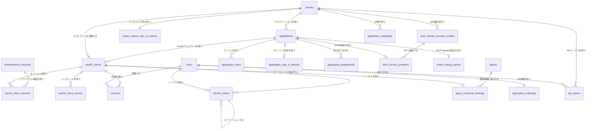
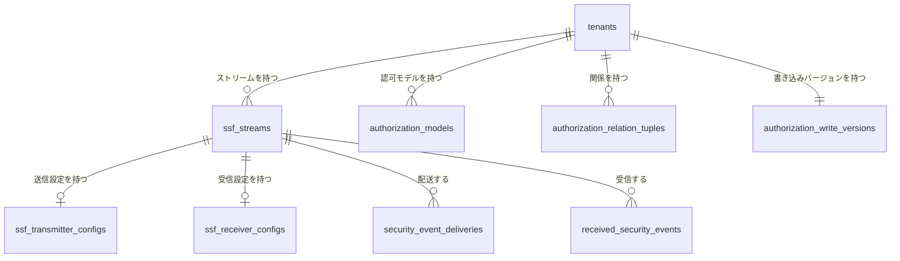

# データベース設計

## スキーマの読み方

現行の物理スキーマは [`infra/schema/postgres.sql`](../../../infra/schema/postgres.sql) が一次情報である。
同ファイルは、WAL に記録する `LOGGED` テーブルと、クラッシュ復旧で内容が消えてもよい `UNLOGGED` テーブルを宣言する。
カラム、索引、検査制約、外部キー、削除規則の完全な定義は同ファイルで確認する。

本節は、物理スキーマにあるすべてのテーブルを機能領域ごとに、ER 図とテーブル一覧の組で示す。
ER 図はテーブルの存在と外部キーだけを示し、カラムを描かない。
線は外部キーを表し、図をまたぐ参照先は該当する図にも再掲する。
外部キーのないテーブルも、存在を見落とさないように図へ含める。
多重度は現在の `NULL` 許容と一意性を要約したものであり、最終的な制約は一次情報の SQL に従う。

テーブル一覧は、SQL からは読み取れないテーブルの意味を記す。
各テーブルは、自身が属する図のテーブル一覧に一度だけ現れ、再掲した図の一覧には現れない。

| 項目 | 内容 |
| --- | --- |
| テーブル | テーブル名 |
| 役割 | そのテーブルが存在する理由。カラムの言い換えではない |
| 所有モジュール | テーブルへ書き込むモジュール。モジュールに属さず共有ライブラリだけが書き込む技術基盤は「共通基盤」とする |
| テーブル種別 | `LOGGED` または `UNLOGGED` |
| `tenant_id` カラム | `単独主キー`（`tenant_id` だけで主キーを構成する）、`複合主キーの一部`、`非キーカラム`（主キーに含まれないカラム）、`なし`（カラムが存在しない）。どれを選ぶかは [`tenant_id` の保持区分](#tenant_id-の保持区分)が定める |

`mise run check-schema-tables` は、テーブル一覧のテーブル名の集合、テーブル種別、`tenant_id` カラムの区分が `postgres.sql` と一致することを確かめる。
役割は検査の対象外なので、スキーマを変えるときに同じ変更の中で見直す。
所有モジュールは、`mise run check-boundaries` がクエリの書き込み先と照合する宣言である。

### テナント、利用者、認証

```mermaid
erDiagram
    tenants {
    }
    tenant_quotas {
    }
    tenant_usages {
    }
    tenant_brandings {
    }
    notification_templates {
    }
    tenant_branding_assets {
    }
    users {
    }
    mfa_factors {
    }
    mfa_enrollment_bypasses {
    }
    webauthn_credentials {
    }
    recovery_codes {
    }
    trusted_devices {
    }
    notification_preferences {
    }
    known_sign_in_devices {
    }
    signing_keys {
    }
    vault_signing_key_sets {
    }
    tenant_data_encryption_keys {
    }
    password_history {
    }
    password_reset_tokens {
    }
    authentication_sessions {
    }
    email_change_tokens {
    }
    user_unique_attribute_values {
    }
    tenants ||--|| tenant_quotas : 上限を持つ
    tenants ||--|| tenant_usages : 使用量を持つ
    tenants ||--|| tenant_brandings : 外観を持つ
    tenants ||--o{ notification_templates : 通知文面を持つ
    tenants ||--o{ tenant_branding_assets : 素材を持つ
    tenants ||--o{ users : 利用者を持つ
    tenants ||--o{ mfa_enrollment_bypasses : 例外を持つ
    tenants ||--o{ trusted_devices : 信頼済み端末を持つ
    tenants ||--o{ signing_keys : 署名鍵を持つ
    tenants ||--o{ vault_signing_key_sets : Vaultの署名鍵の状態を持つ
    tenants ||--o{ tenant_data_encryption_keys : データ暗号鍵を持つ
    tenants ||--o{ authentication_sessions : セッションを持つ
    users ||--o{ mfa_factors : 認証要素を持つ
    users ||--o{ mfa_enrollment_bypasses : 適用される
    users ||--o{ webauthn_credentials : 資格情報を持つ
    users ||--o{ recovery_codes : 回復コードを持つ
    users ||--o{ trusted_devices : 端末を信頼する
    users ||--|| notification_preferences : 通知設定を持つ
    users ||--o{ known_sign_in_devices : 既知端末を持つ
    users ||--o{ password_history : 履歴を持つ
    users ||--o{ password_reset_tokens : 再設定する
    users ||--o{ authentication_sessions : サインインする
    users ||--o{ email_change_tokens : メールを変更する
    users ||--o{ user_unique_attribute_values : 一意の値を持つ
```

| テーブル | 役割 | 所有モジュール | テーブル種別 | `tenant_id` カラム |
| --- | --- | --- | --- | --- |
| `tenants` | テナントそのもの。realm、状態、テナント単位で上書きした方針を記録する | Tenancy | `LOGGED` | なし |
| `tenant_quotas` | テナントが作成できるリソースの上限 | Tenancy | `LOGGED` | 単独主キー |
| `tenant_usages` | 上限と照合する現在の使用量。リソースを作成するたびに全件を数えずに上限を判定するための集計 | Tenancy | `LOGGED` | 単独主キー |
| `tenant_brandings` | サインイン画面や通知に使う外観の設定 | Tenancy | `LOGGED` | 単独主キー |
| `notification_templates` | テナントが上書きした通知メールの文面。レコードがなければ組込みの文面を使う | Tenancy | `LOGGED` | 複合主キーの一部 |
| `tenant_branding_assets` | 外観の設定が参照するロゴとファビコンの画像本体 | Tenancy | `LOGGED` | 非キーカラム |
| `users` | 利用者の Aggregate。属性、ロール、ライフサイクルの状態、パスワードハッシュを格納する | IdManagement | `LOGGED` | 非キーカラム |
| `mfa_factors` | 利用者が登録した TOTP などの第二要素と、その暗号化済みシークレット | Authentication | `LOGGED` | なし |
| `mfa_enrollment_bypasses` | 管理者が発行する、MFA の登録期限の一回限りの免除。消費、失効、期限切れを記録する | Authentication | `LOGGED` | 非キーカラム |
| `webauthn_credentials` | 登録済みの WebAuthn 資格情報（パスキーを含む）と署名カウンター | Authentication | `LOGGED` | なし |
| `recovery_codes` | 第二要素を失ったときに使う回復コードのハッシュ | Authentication | `LOGGED` | なし |
| `trusted_devices` | MFA を省略できる信頼済み端末。Cookie のセレクターと検証子のハッシュで照合する | Authentication | `LOGGED` | 非キーカラム |
| `notification_preferences` | 利用者が受信を止めたセキュリティ通知の分類 | Authentication | `LOGGED` | なし |
| `known_sign_in_devices` | 過去にサインインした端末の指紋。未知の端末からのサインインを通知するために使う | Authentication | `LOGGED` | なし |
| `signing_keys` | トークンとアサーションに署名する鍵の世代と公開鍵 | SigningKeys | `LOGGED` | 非キーカラム |
| `vault_signing_key_sets` | Vault の公開鍵とバージョンと有効な世代の選択。秘密鍵を含まない | SigningKeys | `LOGGED` | 複合主キーの一部 |
| `tenant_data_encryption_keys` | 可逆な秘密情報を暗号化するテナントごとの DEK。ラップ済みの鍵と、バージョンごとの状態を記録する | DataKeys | `LOGGED` | 非キーカラム |
| `password_history` | 再利用を禁じるための過去のパスワードハッシュ | Authentication | `LOGGED` | なし |
| `password_reset_tokens` | パスワードの再設定と初期設定のリンクに埋める使い捨てトークンのハッシュ | Authentication | `LOGGED` | なし |
| `authentication_sessions` | サインイン済みのブラウザーセッション。認証時刻、認証方式、MFA の登録待ちと段階的な認証の状態を記録する | Authentication | `LOGGED` | 非キーカラム |
| `email_change_tokens` | メールアドレス変更の確認リンクに埋める使い捨てトークンのハッシュ | IdManagement | `LOGGED` | なし |
| `user_unique_attribute_values` | 属性スキーマで `unique` と定義した属性の、削除されていない User の値。User の保存と同じトランザクションで書き、主キーが値の重なりを拒否する | IdManagement | `LOGGED` | 複合主キーの一部 |

### フェデレーション、グループ、監査、エージェント

```mermaid
erDiagram
    tenants {
    }
    users {
    }
    identity_provider_connections {
    }
    federated_identities {
    }
    federated_login_attempts {
    }
    federated_response_replays {
    }
    groups {
    }
    group_members {
    }
    dynamic_group_rules {
    }
    tenant_user_attribute_schemas {
    }
    tenant_group_attribute_schemas {
    }
    audit_events {
    }
    authentication_event_buckets {
    }
    tenant_correlation_salts {
    }
    audit_event_search_attributes {
    }
    agents {
    }
    authorization_detail_types {
    }
    mcp_resource_servers {
    }
    cross_app_access_issue_policies {
    }
    cross_app_access_redeem_policies {
    }
    workload_trust_bundles {
    }
    agent_workload_bindings {
    }
    agent_revocation_epochs {
    }
    user_revocation_epochs {
    }
    tenants ||--o{ identity_provider_connections : 接続を持つ
    identity_provider_connections ||--o{ federated_identities : 外部主体を結ぶ
    identity_provider_connections ||--o{ federated_login_attempts : 試行を処理する
    users ||--o{ federated_identities : 外部主体と結ばれる
    users ||--o{ federated_login_attempts : 試行に結ばれる
    tenants ||--o{ federated_response_replays : 再送を記録する
    tenants ||--o{ groups : グループを持つ
    groups ||--o{ group_members : メンバーを持つ
    users ||--o{ group_members : 所属する
    groups ||--o| dynamic_group_rules : 動的規則を持つ
    tenants ||--|| tenant_user_attribute_schemas : 利用者属性を定義する
    tenants ||--|| tenant_group_attribute_schemas : グループ属性を定義する
    audit_events ||--o{ audit_event_search_attributes : 検索属性を持つ
    tenants ||--o{ agents : エージェントを持つ
    users ||--o{ agents : 所有する
    tenants ||--o{ authorization_detail_types : 認可詳細型を持つ
    tenants ||--o{ mcp_resource_servers : リソースサーバーを持つ
    tenants ||--o{ cross_app_access_issue_policies : ID-JAG の発行を許可する
    tenants ||--o{ cross_app_access_redeem_policies : ID-JAG の受け入れを許可する
    tenants ||--o{ workload_trust_bundles : 信頼束を持つ
    tenants ||--o{ agent_workload_bindings : 対応を持つ
    workload_trust_bundles ||--o{ agent_workload_bindings : 主体を許可する
    agents ||--o{ agent_workload_bindings : ワークロードに結ばれる
    agents ||--|| agent_revocation_epochs : 失効世代を持つ
    users ||--o| user_revocation_epochs : 失効世代を持つ
```

| テーブル | 役割 | 所有モジュール | テーブル種別 | `tenant_id` カラム |
| --- | --- | --- | --- | --- |
| `identity_provider_connections` | 外部 IdP（OIDC、SAML）との接続設定。クレームの対応付け、アカウント連携と JIT 作成の方針を含む | Authentication | `LOGGED` | 非キーカラム |
| `federated_identities` | 外部 IdP の主体と、このテナントの利用者の対応 | Authentication | `LOGGED` | 複合主キーの一部 |
| `federated_login_attempts` | 外部 IdP へ送り出したサインインの state、nonce、PKCE。戻ってきた応答を照合するまで保持する | Authentication | `LOGGED` | 複合主キーの一部 |
| `federated_response_replays` | 受け取った外部 IdP の応答の ID。同じ応答の再送を拒否する | Authentication | `LOGGED` | 複合主キーの一部 |
| `groups` | グループの Aggregate。属性、ロール、所属の決め方（静的、動的）を格納する | IdManagement | `LOGGED` | 非キーカラム |
| `group_members` | グループと利用者の所属。手動か動的規則かという所属の由来も記録する | IdManagement | `LOGGED` | なし |
| `dynamic_group_rules` | 動的グループの所属を決める式と、式が参照する属性 | IdManagement | `LOGGED` | 非キーカラム |
| `tenant_user_attribute_schemas` | テナントが定義する利用者の拡張属性 | IdManagement | `LOGGED` | 単独主キー |
| `tenant_group_attribute_schemas` | テナントが定義するグループの拡張属性 | IdManagement | `LOGGED` | 単独主キー |
| `audit_events` | 各モジュールが発行した監査イベント。追記だけで保持する | Audit | `LOGGED` | 非キーカラム |
| `audit_export_artifacts` | Job ID とテナントに束縛した監査成果物のメタデータと公開状態 | Audit | `LOGGED` | 非キーカラム |
| `audit_export_chunks` | 公開前後の監査成果物を構成する固定サイズのチャンク | Audit | `LOGGED` | なし |
| `authentication_event_buckets` | 同じ鍵から続く認証失敗を 5 分の時間枠で数える集計。攻撃による急増で監査イベントのレコードを増やさない | Authentication | `LOGGED` | 複合主キーの一部 |
| `tenant_correlation_salts` | 利用者名や IP アドレスを相関用にハッシュするときのテナントごとのソルト | 共通基盤 | `LOGGED` | 単独主キー |
| `audit_event_search_attributes` | 監査イベントの検索属性の索引。個人識別情報は変換済みの値だけを置く | Audit | `LOGGED` | 非キーカラム |
| `agents` | エージェントの Aggregate。所有者、状態、ロールを格納する | IdManagement | `LOGGED` | 非キーカラム |
| `authorization_detail_types` | テナントが受け付ける `authorization_details` の型の定義 | OAuth2 | `LOGGED` | 複合主キーの一部 |
| `mcp_resource_servers` | トークンの宛先として登録した MCP のリソースサーバーと、そのスコープ、評価用のクライアントと規則 | OAuth2 | `LOGGED` | 非キーカラム |
| `cross_app_access_issue_policies` | ID-JAG の発行の許可 | OAuth2 | `LOGGED` | 非キーカラム |
| `cross_app_access_redeem_policies` | ID-JAG の受け入れの許可 | OAuth2 | `LOGGED` | 非キーカラム |
| `workload_trust_bundles` | ワークロード ID のトークンを検証する信頼ドメインと鍵 | WorkloadIdentity | `LOGGED` | 非キーカラム |
| `agent_workload_bindings` | 信頼ドメインのワークロード主体とエージェントの対応 | WorkloadIdentity | `LOGGED` | 非キーカラム |
| `token_vault_connectors` | 外部サービスのコネクタ。クライアントシークレットは暗号化する | TokenVault | `LOGGED` | 非キーカラム |
| `token_vault_connections` | 本人とコネクタの組ごとの上流トークン。トークンは暗号化する | TokenVault | `LOGGED` | 非キーカラム |
| `token_vault_attempts` | 連携の `state` のハッシュと暗号化した PKCE の検証子。一度だけ消費する | TokenVault | `LOGGED` | 非キーカラム |
| `agent_revocation_epochs` | エージェントの失効世代。世代を進めると、それより前に発行したトークンを受け付けない | SharedSignals | `LOGGED` | 非キーカラム |
| `user_revocation_epochs` | User の失効世代。世代を進めると、それより前に発行したトークンを受け付けない | SharedSignals | `LOGGED` | 非キーカラム |

`audit_events`、`authentication_event_buckets`、`tenant_correlation_salts`、`audit_event_search_attributes` は、監査データの保持や匿名化を独立して制御するため、`tenants` テーブルへの外部キーを置かない。

### アプリケーション、OAuth、SAML、WS-Federation

| テーブル | 役割 | 所有モジュール | テーブル種別 | `tenant_id` カラム |
| --- | --- | --- | --- | --- |
| `applications` | アプリケーションの Aggregate。ポータルに並ぶ単位で、プロトコルごとの設定を束ねる | Application | `LOGGED` | 非キーカラム |
| `oauth2_clients` | OAuth 2.0 と OIDC のクライアントの登録内容 | OAuth2 | `LOGGED` | 非キーカラム |
| `oauth2_client_sessions` | 一つのサインインセッションでトークンを受け取ったクライアント。ログアウトを伝える先を決める | OAuth2 | `LOGGED` | 複合主キーの一部 |
| `oauth2_client_secrets` | ローテーション中に並存するクライアントシークレットのハッシュと期限 | OAuth2 | `LOGGED` | なし |
| `consents` | 利用者がクライアントに与えた同意と、Agent に与えた代行の付与。スコープを持つ | OAuth2 | `LOGGED` | なし |
| `refresh_tokens` | リフレッシュトークンのハッシュ。ローテーションの系譜をたどって再利用を検知する | OAuth2 | `LOGGED` | なし |
| `agent_credential_bindings` | エージェントと、そのエージェントが使う OAuth クライアントの対応 | IdManagement | `LOGGED` | なし |
| `application_icons` | アプリケーションのアイコン画像本体 | Application | `LOGGED` | なし |
| `application_sign_in_policies` | アプリケーション単位のサインイン方針 | SignInPolicy | `LOGGED` | なし |
| `tenant_default_sign_in_policies` | 個別のサインイン方針が設定されていないアプリケーションに適用するデフォルトのサインイン方針 | SignInPolicy | `LOGGED` | 単独主キー |
| `application_assignments` | アプリケーションを使える利用者とグループ、ポータルに表示するかどうか | Application | `LOGGED` | なし |
| `saml_identity_provider_profiles` | SAML IdP として名乗る設定の組。SP ごとに選ぶ | Saml | `LOGGED` | 複合主キーの一部 |
| `saml_service_providers` | SAML SP の登録内容 | Saml | `LOGGED` | 複合主キーの一部 |
| `wsfed_relying_parties` | WS-Federation の Relying Party の登録内容 | WsFederation | `LOGGED` | 複合主キーの一部 |
| `application_orderings` | 利用者ごとの、ポータルでのアプリケーションの並び順 | Application | `LOGGED` | なし |
| `application_categories` | ポータルでアプリケーションをまとめる分類 | Application | `LOGGED` | 複合主キーの一部 |
| `api_tokens` | 管理 API 用に利用者へ発行した長期トークンの記録と失効の状態 | ApiTokens | `LOGGED` | 非キーカラム |

### SCIM、ライフサイクル、プロビジョニング、ジョブ

```mermaid
erDiagram
    tenants {
    }
    users {
    }
    groups {
    }
    applications {
    }
    scim_user_refs {
    }
    scim_group_refs {
    }
    directory_connectors {
    }
    directory_user_correlations {
    }
    directory_ingestion_runs {
    }
    directory_ingestion_batches {
    }
    jobs {
    }
    oauth2_logout_notifications {
    }
    csv_artifacts {
    }
    csv_artifact_chunks {
    }
    audit_export_artifacts {
    }
    audit_export_chunks {
    }
    lifecycle_workflows {
    }
    lifecycle_workflow_revisions {
    }
    lifecycle_workflow_runs {
    }
    lifecycle_workflow_steps {
    }
    token_vault_connectors {
    }
    token_vault_connections {
    }
    token_vault_attempts {
    }
    provisioning_connections {
    }
    provisioning_remote_links {
    }
    provisioning_tasks {
    }
    provisioning_scheduled_deprovisions {
    }
    provisioning_full_resyncs {
    }
    provisioning_full_resync_tasks {
    }
    tenants ||--o{ scim_user_refs : SCIM利用者を持つ
    users ||--o| scim_user_refs : SCIM利用者に対応する
    tenants ||--o{ scim_group_refs : SCIMグループを持つ
    groups ||--o| scim_group_refs : SCIMグループに対応する
    tenants ||--o{ directory_connectors : ディレクトリの取り込み元を持つ
    directory_connectors ||--o{ directory_user_correlations : 外部の不変IDを対応付ける
    users ||--o| directory_user_correlations : ディレクトリの利用者に対応する
    directory_connectors ||--o{ directory_ingestion_runs : 取り込みを実行する
    directory_ingestion_runs ||--o{ directory_ingestion_batches : バッチを記録する
    tenants ||--o{ jobs : ジョブを持つ
    tenants ||--o{ oauth2_logout_notifications : ログアウト通知を持つ
    tenants ||--o{ csv_artifacts : CSV成果物を持つ
    csv_artifacts ||--o{ csv_artifact_chunks : 分割片を持つ
    tenants ||--o{ audit_export_artifacts : 監査成果物を持つ
    jobs ||--o{ audit_export_artifacts : 生成する
    audit_export_artifacts ||--o{ audit_export_chunks : 分割片を持つ
    tenants ||--o{ lifecycle_workflows : ワークフローを持つ
    lifecycle_workflows ||--o{ lifecycle_workflow_revisions : 改訂する
    lifecycle_workflows ||--o{ lifecycle_workflow_runs : 実行する
    users ||--o{ lifecycle_workflow_runs : 対象になる
    lifecycle_workflow_runs ||--o{ lifecycle_workflow_steps : 手順を持つ
    tenants ||--o{ token_vault_connectors : コネクタを分離する
    token_vault_connectors ||--o{ token_vault_connections : 接続を持つ
    token_vault_connectors ||--o{ token_vault_attempts : 連携を持つ
    users ||--o{ token_vault_connections : 接続を持つ
    users ||--o{ token_vault_attempts : 連携を開始する
    applications ||--o| provisioning_connections : 接続を持つ
    tenants ||--o{ provisioning_connections : 接続を分離する
    provisioning_connections ||--o{ provisioning_remote_links : 遠隔主体を結ぶ
    provisioning_connections ||--o{ provisioning_tasks : 作る
    provisioning_connections ||--o{ provisioning_scheduled_deprovisions : 削除を予約する
    provisioning_connections ||--o{ provisioning_full_resyncs : 全件を再同期する
    provisioning_full_resyncs ||--o{ provisioning_full_resync_tasks : 対象を持つ
    provisioning_tasks ||--o| provisioning_full_resync_tasks : 再同期に属する
```

| テーブル | 役割 | 所有モジュール | テーブル種別 | `tenant_id` カラム |
| --- | --- | --- | --- | --- |
| `scim_user_refs` | SCIM クライアントが指定した外部 ID と利用者の対応 | Sourcing | `LOGGED` | 複合主キーの一部 |
| `scim_group_refs` | SCIM クライアントが指定した外部 ID とグループの対応 | Sourcing | `LOGGED` | 複合主キーの一部 |
| `directory_connectors` | 閉域のディレクトリから取り込む Directory Connector の登録と状態 | Sourcing | `LOGGED` | 非キーカラム |
| `directory_user_correlations` | Connector と外部の不変 ID の組から利用者への対応と、最後に現れた取り込みの実行 | Sourcing | `LOGGED` | 複合主キーの一部 |
| `directory_ingestion_runs` | Directory Connector の取り込みの実行の状態と結果ごとの件数 | Sourcing | `LOGGED` | 非キーカラム |
| `directory_ingestion_batches` | 取り込みの実行に記録したバッチの項目のダイジェストと項目ごとの結果 | Sourcing | `LOGGED` | 非キーカラム |
| `jobs` | 非同期ジョブのキュー。リースと再試行の状態を管理する | Jobs | `LOGGED` | 非キーカラム |
| `oauth2_logout_notifications` | バックチャネルログアウト通知の一件ごとの配送状態 | OAuth2 | `LOGGED` | 非キーカラム |
| `csv_artifacts` | CSV インポートの入力と結果の成果物。本体は分割片に置く | IdManagement | `LOGGED` | 非キーカラム |
| `csv_artifact_chunks` | 成果物の本体を分けた断片 | IdManagement | `LOGGED` | なし |
| `lifecycle_workflows` | 利用者の変化を契機に実行するワークフローの定義 | IdGovernance | `LOGGED` | 非キーカラム |
| `lifecycle_workflow_revisions` | ワークフロー定義の改訂。実行は開始時の改訂を固定して参照する | IdGovernance | `LOGGED` | 非キーカラム |
| `lifecycle_workflow_runs` | 一人の利用者に対するワークフローの一回の実行 | IdGovernance | `LOGGED` | 非キーカラム |
| `lifecycle_workflow_steps` | 実行の各手順の結果 | IdGovernance | `LOGGED` | なし |
| `provisioning_connections` | アプリケーションへ利用者とグループを送り出す SCIM 接続の設定と健全性 | Provisioning | `LOGGED` | 非キーカラム |
| `provisioning_remote_links` | 送り出した利用者やグループと、接続先での ID の対応 | Provisioning | `LOGGED` | 非キーカラム |
| `provisioning_tasks` | 接続先への一件ごとのプロビジョニングタスクと、その状態 | Provisioning | `LOGGED` | 非キーカラム |
| `provisioning_scheduled_deprovisions` | 猶予期間を置く利用者の削除の予約。期限が来るとプロビジョニングタスクへ変わり、猶予期間中の再割り当てで取り消される | Provisioning | `LOGGED` | 非キーカラム |
| `provisioning_full_resyncs` | フル同期の一回分。開始時の対象数と、完了時の成功数と失敗数 | Provisioning | `LOGGED` | 非キーカラム |
| `provisioning_full_resync_tasks` | フル同期と、それが作ったプロビジョニングタスクの対応 | Provisioning | `LOGGED` | なし |

### 再生成可能な認証状態と流量制御

この図のテーブルは、認証リクエスト、短命なコード、再送検知、流量制御など、期限付きで正本の業務状態から切り離せるデータだけを格納する。
大半は `UNLOGGED` テーブルであり、クラッシュ復旧後やフェイルオーバー後に内容が失われ得る。
失われても、利用者が認証をやり直せば済むからである。

`oauth2_access_token_denylist` と `login_throttle_counters` は、同じ種類の短命な状態だが `LOGGED` テーブルにする。
前者が失われると失効させたアクセストークンが期限まで再び通り、後者が失われるとロックアウトが解ける。
どちらもフェイルクローズの前提が崩れるため、WAL への書き込みの費用を払う。

```mermaid
erDiagram
    tenants {
    }
    users {
    }
    oauth2_clients {
    }
    oauth2_authorization_requests {
    }
    oauth2_authorization_codes {
    }
    oauth2_par_requests {
    }
    oauth2_device_codes {
    }
    oauth2_approval_requests {
    }
    oauth2_replay_jtis {
    }
    oauth2_access_token_denylist {
    }
    webauthn_sessions {
    }
    login_throttle_counters {
    }
    endpoint_rate_limit_counters {
    }
    saml_authnrequest_replays {
    }
    tenants ||--o{ oauth2_authorization_requests : 認可要求を持つ
    tenants ||--o{ oauth2_authorization_codes : 認可コードを持つ
    tenants ||--o{ oauth2_par_requests : PAR要求を持つ
    tenants ||--o{ oauth2_device_codes : デバイスコードを持つ
    users ||--o{ oauth2_device_codes : 承認する
    tenants ||--o{ oauth2_approval_requests : 承認要求を持つ
    oauth2_clients ||--o{ oauth2_approval_requests : 承認を求める
    users ||--o{ oauth2_approval_requests : 承認する
    tenants ||--o{ oauth2_replay_jtis : 再送識別子を持つ
    tenants ||--o{ oauth2_access_token_denylist : 拒否対象を持つ
    tenants ||--o{ webauthn_sessions : WebAuthn状態を持つ
    tenants ||--o{ login_throttle_counters : サインイン回数を持つ
    tenants ||--o{ endpoint_rate_limit_counters : API回数を持つ
    tenants ||--o{ saml_authnrequest_replays : SAML再送を持つ
```

| テーブル | 役割 | 所有モジュール | テーブル種別 | `tenant_id` カラム |
| --- | --- | --- | --- | --- |
| `oauth2_authorization_requests` | 認可エンドポイントで受け付け、サインインの完了を待っている要求 | OAuth2 | `UNLOGGED` | 非キーカラム |
| `oauth2_authorization_codes` | 発行した認可コードと、交換済みかどうか | OAuth2 | `UNLOGGED` | 非キーカラム |
| `oauth2_par_requests` | PAR で先に預かった認可要求 | OAuth2 | `UNLOGGED` | 非キーカラム |
| `oauth2_device_codes` | デバイス認可フローのコードと承認の状態 | OAuth2 | `UNLOGGED` | 非キーカラム |
| `oauth2_approval_requests` | CIBA の承認要求と、クライアントのポーリングの状態 | OAuth2 | `UNLOGGED` | 非キーカラム |
| `oauth2_replay_jtis` | 一度だけ受け付ける JWT の `jti`。同じ JWT の再送を拒否する | OAuth2 | `UNLOGGED` | 複合主キーの一部 |
| `oauth2_access_token_denylist` | 失効させたアクセストークンの `jti`。トークンの期限まで拒否する | OAuth2 | `LOGGED` | 複合主キーの一部 |
| `webauthn_sessions` | WebAuthn の登録と認証で発行したチャレンジ | Authentication | `UNLOGGED` | 複合主キーの一部 |
| `login_throttle_counters` | サインイン失敗の回数とロックアウトの期限 | Authentication | `LOGGED` | 複合主キーの一部 |
| `endpoint_rate_limit_counters` | エンドポイントごとの流量制御の回数 | 共通基盤 | `UNLOGGED` | 複合主キーの一部 |
| `saml_authnrequest_replays` | 受け取った SAML AuthnRequest の ID。同じ要求の再送を拒否する | Saml | `UNLOGGED` | 複合主キーの一部 |

### セキュリティイベントと認可関係

| テーブル | 役割 | 所有モジュール | テーブル種別 | `tenant_id` カラム |
| --- | --- | --- | --- | --- |
| `ssf_streams` | SSF の送信ストリームまたは受信ストリーム | SharedSignals | `LOGGED` | 非キーカラム |
| `ssf_transmitter_configs` | 送信ストリームの配送先と、配送時の認証 | SharedSignals | `LOGGED` | 非キーカラム |
| `ssf_receiver_configs` | 受信ストリームで信頼する発行者と鍵 | SharedSignals | `LOGGED` | 非キーカラム |
| `security_event_deliveries` | 送信する SET の一件ごとの配送状態と再試行。監査の配送は内容を持ち、送信時に署名する | SharedSignals | `LOGGED` | 非キーカラム |
| `received_security_events` | 受信した SET と、その検証結果、反映した時刻 | SharedSignals | `LOGGED` | 非キーカラム |
| `authorization_models` | テナントの関係ベース認可のモデル定義と、そのバージョン | AccessControl | `LOGGED` | 非キーカラム |
| `authorization_relation_tuples` | リソースと主体の関係 | AccessControl | `LOGGED` | 複合主キーの一部 |
| `authorization_write_versions` | 関係を書き込むたびに進む、テナント単位のバージョン番号 | AccessControl | `LOGGED` | 単独主キー |

### 所有と書き込みの境界

各モジュールは、永続化ポートを通じて自身が所有するテーブルを読み書きする。
`mise run check-boundaries` の `table-write` は、`sqlc.yaml` が宣言するすべてのクエリ入力について、SQL が明示的に書き込むテーブルと上の一覧の所有モジュールを照合する。
クエリ入力の配置は、[バックエンド設計](../application/backend.md#パッケージの三種類)の三種類で分類する。

| 書き込む側 | 書き込めるテーブル |
| --- | --- |
| モジュールの `db_postgres` | そのモジュールが所有するテーブル |
| 共有ライブラリ | 所有が「共通基盤」のテーブル |
| 組み立て地点 | なし。組み立て地点は書き込み検査の例外にしない |

書き込み先は、`sqlc parse` が返す PostgreSQL の構文木から読む。
`INSERT`（`ON CONFLICT DO UPDATE` を含む）、`UPDATE`、`DELETE`、`TRUNCATE`、書き込みを含む CTE の全対象を扱い、コメントと文字列中の語、別名、引用識別子、スキーマ修飾を区別する。
構文木へ変換されない文（`MERGE` など）、解決できないテーブル、所有者の欠落や重複は、違反がないものとして通さず、入力の診断として検査を失敗させる。
違反 ID は、書き込むモジュール、クエリ入力のパス、クエリ名、操作、対象テーブル、書き込む列の集合から決まるので、既存のクエリが別の列へ書き始めると新しい違反になる。

この検査が判定するのは SQL に書いた直接の対象だけである。
外部キーの cascade、トリガー、関数の呼び出し、`//sql:raw` の動的な SQL による書き込みは判定しない。
読み取りも拒否しないため、SQL の結合によるほかのモジュールの保存表現への依存は残る。
これらは[境界を選ぶ判断手順](../application/design-guidelines.md#境界を選ぶ判断手順)の入力として調べる。
現在、検査の外にある書き込みの経路には、`tenants` の挿入時に SAML のデフォルトのプロファイルを作るトリガーと、`ON DELETE CASCADE` の外部キーがある。

現在、所有モジュールの外から行う直接の書き込みの例外はない。
CSV インポートの監査とパスワードの履歴は、Audit と Authentication が公開する、呼び出し側のトランザクションへ参加する操作を通す。
同じトランザクションで確定しなければ整合が崩れるため、所有者の公開操作を別のトランザクションで呼ばない。
Group の CSV の再評価ジョブは、同じトランザクションへ結んだ Jobs の公開投入操作を通す。
Jobs がレーン、重複排除とクォータを担い、行の確定後にだけ投入イベントを発行する。
所有モジュールの外へ直接の書き込みを加える変更は、`mise run check-boundary-debt-ratchet` が拒否する。

スキーマを変えるときは、テーブルの追加と削除、外部キーの変更、テーブル種別を確認し、同じ変更の中で ER 図とテーブル一覧を更新する。
変更の進め方は[スキーマ管理](schema-management.md)が定める。

## ポートとアダプター

永続化ポートと Repository の実装は、対応するモジュールに属する。モジュール固有のメモリと PostgreSQL のアダプターは `backend/<module>/{db_memory,db_postgres}` に置き、共有のデータベース接続プール、レコードの読み取り、トランザクションのヘルパーは `backend/shared/storage/db_postgres` に置く。一時的な状態も PostgreSQL に統合するため、2 種類目のデータストアは運用しない。

`db_postgres` の静的な SQL 文はすべて `sqlc` の入力とし、型安全な Go コードを生成しなければならない。省略できる絞り込みは `sqlc.narg` で、閉じた集合からカラムを選ぶ文はカラムごとの問い合わせで表す。SQL 文字列を直接渡す `Exec`、`Query`、`QueryRow` は、`sqlc` で表せない次の場合に限って許される。

| 場合 | 例 |
| --- | --- |
| 条件の数や演算子が要求ごとに変わる | 監査イベントの検索で、絞り込み式の数だけ `EXISTS` を連言でつなぐ |
| DDL を適用する | テストと開発環境で `infra/schema/postgres.sql` を投入する |
| `sqlc` の生成コードから受け取った SQL を中継する | `DBTX` を実装する `ResilientDB` |
| 接続ごとのセッションを設定する | 接続の確立時に `statement_timeout` を設定する |

例外とする呼び出しは、その直前の行に `//sql:raw <理由>` を書く。`mise run check-repository` の `raw-sql` 検査は、`backend/` のテスト以外の Go コードから、第 1 引数に context を取るこれらの呼び出しを探し、理由のある印がないものを拒否する。

PostgreSQL の構造をどう変え、どう適用するかは[スキーマ管理](schema-management.md)が定める。

## 同時の更新と排他

Repository の保存は、Aggregate 全体を ID で上書きする（`ON CONFLICT (id) DO UPDATE`）。
保存する値は先に読んだ Aggregate から作るので、読んでから保存するまでに別の書き手が同じ行を変えると、保存がその変更を古い値で書き戻す。
書き戻しを防ぐ形は、書き手の種類で決める。

| 書き手 | 保存の形 | 防ぐ故障 |
| --- | --- | --- |
| 利用者や管理者が Aggregate を編集する操作 | Aggregate を丸ごと保存し、同じ Aggregate の同時の編集はバージョンで検出する（[ETag と If-Match による競合検出](../application/api-guidelines.md#etag-と-if-match-による競合検出)） | 二人の管理者の編集の一方が黙って失われる |
| 利用者や管理者が編集しない値（時刻、外部から取得した結果、計数、ほかの値から導く値）だけを記録する処理 | その列だけを書く更新を、Repository の専用の操作にする。記録する値が、無効化の状態などと同じ JSONB の列にあるか、記録の前に最新の値から判定する必要があるときは、行を `FOR UPDATE` で固定して読み直し、その最新の値へ変更を当てる操作にする | 最終ログイン時刻の記録が、同時の無効化を書き戻す |
| 自動の書き手による状態の遷移 | 遷移の前の状態を条件にした一つの更新文にする | 自動の無効化と管理者の編集が重なり、無効にした対象が有効に戻る |
| 外部への取得や長い計算をはさむ処理 | 取得の前に読んだ Aggregate を、取得の後に丸ごと保存しない。取得の結果だけを記録する | 数秒の取得の間に行われた無効化を書き戻す |

すべての保存を列ごとの更新にはしない。
状態と期限の組のように複数の値にまたがる不変条件は、Aggregate の構築と状態遷移が検査する（[型の所有と不変条件](../application/design-guidelines.md#型の所有と不変条件)）。
列ごとの更新に分けると、その検査が SQL の条件に散らばり、どの組み合わせを検査したかがコードから読めなくなる。

読んだ後に書く処理は、その間を次のどれかで守る。

| 形 | 守り方 |
| --- | --- |
| 行を固定して読む | `SELECT ... FOR UPDATE` はトランザクションの中で使う。行がないと何も固定しないので、行がないときに続けて挿入する処理は、先に `INSERT ... ON CONFLICT DO NOTHING` で行を作るか、勧告ロックで直列化する |
| 固定せずに読む | 更新する列を `WHERE` でも確かめ、読んだ値のままの行だけを更新する。挿入は既存の行を上書きしない形にする |

`mise run check-sql-concurrency` が、どちらもない形を関数の中のクエリの呼び出しから拒否する。
呼び出し元がロックを持つ場合など、関数の外の守りは、直前の行の `//sql:concurrency-ok <理由>` で宣言する。
この検査は、`FOR UPDATE` なしの別テーブルの読み取りに依る判定や、二段以上先の呼び出しの作用を見ない。

この規則に従う既存の例を次に示す。

| 例 | 形 |
| --- | --- |
| ログインセッションの失効 | `RevokeAuthenticationSession` が `revoked_at` と `revoke_reason` だけを、最初の一回だけ書く。セッションの丸ごとの保存はこの二列を書かない |
| ログインセッションの最終アクセス | `TouchAuthenticationSession` が、前回から一定時間が過ぎたときだけ `last_seen_at` を書く |
| テナントのリソースの使用量 | 使用量の加算を、上限を条件にした一つの更新文で行う。User の使用量の再集計は行を `FOR UPDATE` で固定したまま件数を数えて置き換え、その間の加算と減算を置き換えの後へ待たせる |
| Authentication による User の記録 | ログイン、パスワードの変更と再設定、MFA の状態の記録が、`UserRepository.Update` で行を固定して読み直した User に変更を当てる。最終ログイン時刻、変更時刻、必須操作は無効化の状態と同じ `lifecycle` の列にあり、期限切れの判定も最新の値から行う。再設定はトークンの使用済み化と同じトランザクションで `UserWriter.Update` を使う |
| トラストバンドルの JWKS の確認 | `RecordJWKSFetched` が `jwks_cached_at` だけを書き、取得中の設定の編集を保持する |
| Agent の更新と状態の遷移 | 管理者の更新、無効化と再有効化、停止、所有者の停止に伴う無効化が、`AgentRepository.Update` で行を固定して読み直した Agent に変更を当てる。停止の拒否と変わった項目の判定も最新の値に対して行うので、停止の後に届いた操作が停止を取り消さない |

適用状況：

- バージョンによる検出を持つ管理 API は、ライフサイクルワークフローの `expected_revision` だけである。ほかの Aggregate の編集は後勝ちである。
- IdP の Discovery は、保存を伴わない設定の入力支援である。取得処理は接続の書き手ではなく、管理者による通常の作成と編集だけが設定を保存する。

## カラム型の選択

カラム型の選択を一貫させるため、値の種類ごとに次の型を使う。

| 値の種類 | 採用する型と制約 | 使わない型 | 理由と補足 |
| --- | --- | --- | --- |
| 長さに上限がない自由形式の文字列 | `TEXT` | 制約のない `varchar` | `TEXT` と同じ意味の型を二通りに書かない |
| 長さに上限がある文字列 | `TEXT` + `CHECK (char_length(col) <= N)`。フォーマットが固定された識別子は `CHECK (... ~ regex)` を併せて置く | `varchar(N)` | 上限を型宣言へ分けず、他の `CHECK` と同じ書き方で並べる。`N` の決め方は[文字列長の上限](../application/api-guidelines.md#文字列長の上限)に従う |
| IdMagic が `spec.NewUUIDv4()` で生成する ID | `UUID` | `TEXT` | Go 側は `string` で保持し、pgx のテキスト用符号器（`RegisterUUIDAsText`）が両者を変換する |
| `entity_id` や `wtrealm` など、外部が値を決める ID | `TEXT`。索引の鍵の成分になる場合は `CHECK (char_length(col) <= N AND octet_length(col) <= M)` を 1 つの制約として置く | `UUID` | IdMagic が採番する値ではなく、UUID とも限らない。同じカラムに `CHECK` を 2 つ並べると psqldef の差分が収束しない |
| 時刻 | `TIMESTAMPTZ`。マイクロ秒の精度を正とし、スキーマで丸めない | タイムゾーンのない `TIMESTAMP` | タイムゾーンの解釈を読み手に委ねない |
| 有限の値集合 | `TEXT` + `CHECK (col IN (...))` | PostgreSQL の列挙型 | 値の追加に `ALTER TYPE` が必要で、[宣言的なスキーマ](schema-management.md#宣言的スキーマ)の差分取りと相性が悪い |
| 構造を持つ付随データ | `JSONB` | 結合、絞り込み、外部キー、一意性の制約の対象になる値を `JSONB` の中に置くこと | `JSONB` の中の値には、カラムと同じ制約と索引を宣言できない |

## `tenant_id` の保持区分

`users.id` と `oauth2_clients.client_id` は全テナントで一意なので、子のレコードはその鍵だけで親を参照し、**テナント単位の複合外部キーは使わない**。全体で一意な親からテナントを特定できるという理由だけで、子のテーブルへ `tenant_id` カラムを重複して置かない。`tenant_id` は、検索、制約、保持期間、監査のいずれかに必要な場合にだけ追加する。

| テーブルの種類 | `tenant_id` の扱い | 該当するテーブルの例 | 理由 |
| --- | --- | --- | --- |
| テナントに属する Aggregate | `tenant_id` カラムを置く | `users`、`groups`、`oauth2_clients` | Aggregate がどのテナントに属するかを、そのレコード自身が示す |
| テナント単位で外部に由来する自然キー | `tenant_id` を複合主キーの一部にする | `scim_user_refs` と `scim_group_refs` の `(tenant_id, scim_id)` | 外部の ID がテナント内でしか一意でない |
| 全体で一意な親の子 | 全体で一意な鍵（`user_id` と `client_id`）で識別し、`tenant_id` カラムを置かない | `password_history` | 親からテナントを特定でき、テナントごとの検索や保持期間を必要としない |
| 全体で一意な親の子のうち、不透明な値を鍵として毎回照合するもの | `tenant_id` カラムを置き、フェイルクローズな多層防御の条件として使う | `authentication_sessions`、不透明なトークン、認可コード、チャレンジを鍵とする一時的な認証情報 | Cookie 値などの不透明な鍵をすべてのリクエストで照合するため、親への結合なしにテナント境界を確かめる。テナントごとの有効な一覧にも使う |

## 可逆な秘密情報のエンベロープ暗号

データベースに保存する必要がある可逆なシークレットは、平文で保存しない。差し替え可能な `EnvelopeCrypto` プロバイダーのマスターキーでテナントごとの `DataEncryptionKey`（DEK）をラップし、その DEK で各シークレットを AEAD 暗号化する。AEAD と鍵セットの処理は [Tink](https://developers.google.com/tink) に委ね、nonce、認証タグ、追加認証データの組み立てを自作しない。追加認証データには `(tenant, context, table, record id, field)` と DEK のバージョンを使う。このため、暗号文を別のテナント、テーブル、フィールドへ複製しても復号できない。

- `EnvelopeCrypto`（Tink を使う AEAD と鍵セットのポート、および OpenBao と平文鍵セットによるマスターキー提供元のアダプター）は、`certificates_mtls`、`passwords_argon2id`、`tokens_jose` と並べて `backend/shared/security` に置く。これは業務上の Aggregate ではなく、技術上の共通機能である。
- `backend/datakeys`（`DataKeys` モジュール）は、ラップされた DEK のメタデータとライフサイクル（初期化、ローテーション、無効化、破棄）だけを担い、`EnvelopeCrypto` ポート自体は定義しない。`SigningKeys` が `transit/sign` を暗号化、復号、データ鍵の機能から分離しているのと同じ構成である。
- ローテーションでは新しい DEK のバージョンを以後の書き込み用に有効化し、直前のバージョンを復号可能な `retiring` のまま残す。`backend/jobs` の `JobKind` と `HandlerRegistry` に登録した再開可能な再暗号化ジョブがすべての参照を移行し終えた後にだけ、古いバージョンを破棄できる。`FieldMigrator` ポート（`backend/datakeys/ports`）により、各モジュールは自身の一括再暗号化処理と残件数の算出を登録する。これにより、`DataKeys` はこのポートを利用するモジュールのスキーマへ依存しない。ローテーションは登録された移行処理ごとにジョブを自動投入し、いずれかの移行処理が残件を報告している間はラップされた DEK の消去を拒否する。
- アンラップに失敗した場合、プロバイダーへ到達できない場合、追加認証データが一致しない場合、または改ざんを検知した場合は、フェイルクローズで復号を拒否する。呼び出し元は平文へフォールバックしたり、項目を読み飛ばしたりしない。
- マスターキーの提供元は OpenBao（Vault Transit 互換の HTTP API）である。開発環境とローカル環境では Tink の平文鍵セットを使うため、OpenBao は不要である。提供元は設計上差し替え可能である。
- HTTP の接点は `system_admin` に限定した制御面の管理 API だけである（`backend/datakeys/internal/handlers_http`）。`GET /api/admin/v1/data-keys/health` は各テナントで有効な DEK のバージョンとステータス、マスターキー提供元の名前と到達性を報告する。緊急のローテーションと無効化も同じ境界で公開する。どの応答も鍵素材を返さない。破棄は内部操作とし、管理用エンドポイントを公開しない。

署名鍵の秘密鍵はこの規範の対象ではない。`signing_keys.private_jwk` に何が入るかは `KeyProvider` の選択で決まり、その規範は [SigningKeys の集約](../../modules/signing-keys/data.md#集約) が定める。

DEK の破棄では `tenant_data_encryption_keys` のレコードを削除せず、`wrapped_dek` を `NULL` にして暗号学的に消去する。これにより、鍵素材を失った後も `active`、`retiring`、`disabled`、`destroyed` というライフサイクルの履歴を参照できる。
