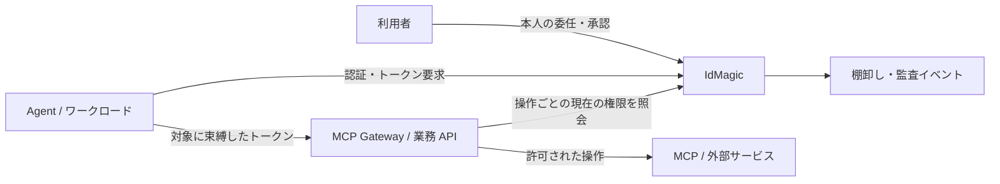

# AI エージェントの ID 管理、認証、認可ガイド

この文書は、IdMagic の AI エージェント向け機能の全体像と、利用パターンごとの設定、実行、確認、停止の手順を案内する。
初めて試す場合は[社内文書アシスタントのデモ](ai-agent-demo-walkthrough.md)を動かし、自分の Agent や接続先を使う場合は下の利用パターンから進む。
詳細ページもこのガイドの一部であり、手順に必要な前提と期待結果を各ページに記載する。

## 利用パターン

| やりたいこと | 実行する主体と認証 | 進むページ |
| --- | --- | --- |
| 画面だけで、文書の閲覧、更新、削除の許可と停止を試す | 台本で動く自律 Agent、公開鍵認証 | [社内文書アシスタントのデモ](ai-agent-demo-walkthrough.md) |
| 夜間の集計やバッチを Agent 自身の権限で動かす | 自律 Agent、`client_credentials` | [ID と認証](ai-agent-demo-identity.md#自律エージェントの公開鍵認証)、[認可](ai-agent-demo-authorization.md) |
| CI、コンテナー、SPIFFE の ID を Agent の ID に結び付ける | 外部 OIDC/JWT または JWT-SVID | [ワークロードによる認証](ai-agent-demo-identity.md#ワークロードによる認証) |
| ログインした本人の代理で操作する | 利用者と Agent、本人の委任と Token Exchange | [利用者からの委任](ai-agent-demo-delegation.md#利用者の代理実行) |
| ブラウザーを開けない端末や CLI から本人の認可を得る | 別端末の利用者、Device Authorization Grant | [端末からの利用者の認可](ai-agent-demo-delegation.md#端末からの利用者の認可) |
| 別の Agent に仕事を引き継ぐ | 元の利用者と `act` の連鎖 | [複数エージェントの委任](ai-agent-demo-delegation.md#複数エージェントの委任) |
| 人が承認したときだけトークンを発行する | 監督下 Agent または自律 Agent、CIBA | [発行前の人の承認](ai-agent-demo-authorization.md#発行前の人の承認) |
| 削除や高額操作を、指定した引数で一回だけ承認する | 利用者、Agent、実行時の認可と操作承認 | [一回の操作の承認](ai-agent-demo-authorization.md#一回の操作の承認) |
| 別の認可サーバーのアプリへ ID を引き継ぐ | 利用者、二つの issuer、ID-JAG | [アプリをまたぐアクセス](ai-agent-demo-delegation.md#アプリをまたぐアクセス) |
| MCP サーバーの前でツールごとに許可を検査する | Agent、セルフホスト型またはマネージド型 Gateway | [MCP と外部サービスの接続](ai-agent-demo-connections.md) |
| 外部 SaaS を本人の接続で操作し、外部のトークンを Agent に渡さない | 利用者の OAuth 連携、TokenVault | [外部サービスとの OAuth 連携](ai-agent-demo-connections.md#外部サービスとの-oauth-連携) |
| 既存の Envoy や業務 API に判定を組み込む | 評価用クライアントと実行する主体を分離 | [Envoy と業務 API](ai-agent-demo-connections.md#envoy-と業務-api) |
| 誰の Agent が動いているか調べ、権限を取り消す | 管理者、所有者、委任した本人 | [停止、棚卸し、監査](ai-agent-demo-operations.md) |

## 機能の全体像

IdMagic は、Agent の ID、認証に使うクライアント、利用者の委任、接続先の操作を別々に管理する。
Agent を登録しただけではツールの実行権限は付かない。
トークンを取得できることと、そのトークンで業務操作が許されることも別の判定である。

| 分野 | 利用できる機能 | 手順 |
| --- | --- | --- |
| ID 管理 | 所有者、種別、複数の認証用クライアントの紐付け、所有者の変更、無効化、有効化、緊急停止、削除 | [ID と認証](ai-agent-demo-identity.md)、[運用](ai-agent-demo-operations.md) |
| 認証 | `private_key_jwt`、`tls_client_auth`、`spiffe_jwt`、外部ワークロード証明の Token Exchange | [ID と認証](ai-agent-demo-identity.md) |
| トークンの保護 | リソース指定、スコープと RAR の上限、DPoP または mTLS による送信者の束縛、refresh token のローテーション | [委任とトークン](ai-agent-demo-delegation.md) |
| 委任 | 本人が許可する Agent、スコープ、有効期限、取消、複数 Agent の `act`、ID-JAG | [委任とトークン](ai-agent-demo-delegation.md) |
| 発行の制限 | テナントのデフォルトと Agent 個別のガードレール、発行頻度、期限、リソース、明細の種類、委任の深さ、トークン有効期間、承認 | [認可と人の承認](ai-agent-demo-authorization.md) |
| 実行の認可 | 公開する MCP ツール、Agent ごとの操作と対象の割当、ReBAC、CEL 条件、回数制限、操作一回の承認 | [認可と人の承認](ai-agent-demo-authorization.md) |
| 権限の説明 | スコープ、RAR の種類、ツールに登録した変更の影響と個人情報の有無を、同意、委任、承認の前に表示 | [認可と人の承認](ai-agent-demo-authorization.md#権限の影響の説明) |
| 接続 | MCP のツール発見とカタログ報告、マネージド型 Gateway、上流への Token Exchange、TokenVault、Envoy、独自 PEP | [接続](ai-agent-demo-connections.md) |
| 運用 | 所有者が停止した Agent の停止、既発行トークンのオンライン失効、棚卸し、外部観測の照合と確認、権限資料、監査 | [停止、棚卸し、監査](ai-agent-demo-operations.md) |

## 識別子と役割

値をコピーするときは、その値を作った画面と使う場所を確認する。
とくに Agent ID と OAuth クライアント ID は交換できない。

| 名前 | 意味と入手先 | 使う場所 |
| --- | --- | --- |
| issuer / realm URL | 認可サーバーの識別子。ローカルでは `http://localhost:5173/realms/default`。公開メタデータの `issuer` で確認する | メタデータ取得、鍵とトークンの検証、信頼設定 |
| Agent ID | 「エージェント」の登録結果 | 資格情報の紐付け、操作の割当、本人の委任、停止、監査 |
| 認証用クライアント ID | Agent に紐付けた OAuth クライアントの ID | Agent がトークンを要求するときの `client_id` |
| 評価用クライアント ID | MCP リソースサーバーの登録時に作成または設定するクライアント | Gateway や業務 API が IdMagic に認可を照会するときの認証 |
| リソース URI | MCP リソースサーバーなどに登録した保護対象の URI | トークン要求の `resource` と対象の照合。末尾の `/` も含めて一致させる |
| ツール名 / 操作 ID | MCP の `tools/call` で使う名前 / 公開時に作成する操作の識別子 | カタログと公開ツールの対応、Agent の操作割当 |
| 対象 ID | 文書システムなどが決める `handbook` のような識別子 | ツール引数、対象ごとのアクセス権、承認明細 |
| 所有者 | Agent の管理責任を持つ利用者 | ライフサイクル、棚卸し、ガードレールの承認。所有者であるだけでは本人の代理実行の委任にならない |
| 委任する本人 | 自分の権限を Agent に使わせる利用者 | 「接続済みアプリ」での委任、TokenVault の接続。所有者と同じ人物である必要はない |

Agent の種別 `autonomous`（自律）と `supervised`（監督下）は、通常のトークン発行を許すか、人の承認を必須にするかの区別である。
トークンの `delegation_mode` は、`direct`、`autonomous`、`on_behalf_of` のいずれかを主体と委任の連鎖から導く。
この二つを同じ設定として扱わない。

## 最初の実行

[ローカル開発の環境の準備](local-development.md#環境の準備)を済ませ、リポジトリのルートで用途に合うコマンドを一つ選ぶ。

| 目的 | コマンド | 実行後 |
| --- | --- | --- |
| 画面で統制を試す | `mise run demo-agent` | <http://localhost:5180/> と <http://localhost:5173/realms/default/admin> を開く |
| 自分で認証や委任を設定する | `mise run dev-memory` | 管理画面とアカウント画面を使い、以下の詳細ページの手順を進める |
| 実在の MCP SDK クライアントで検証する | `mise run test-mcp-client-walkthrough` | TLS の前段、IdMagic、Gateway、SDK クライアントを自動起動し、許可、拒否、取消を検証して終了する |

ローカルの管理者は `alice`、パスワードは `demo-password-1234` である。
これらのローカル環境のデータは使い捨てであり、再起動後に同じ ID や鍵を使い回さない。
`demo-agent` と `dev-memory` は同じポートを使うため、同時に起動しない。
SDK の自動検証は[実在の MCP クライアントの手順](../../examples/mcp-client-walkthrough/README.md)が構成と検証範囲を示す。
外部 IdP、外部 SaaS、実際の SPIFFE 基盤までこのコマンドで構築するわけではない。

このガイドの `/api/...`、`/token`、`/resource-access/...` は realm 内のパスであり、呼び出す際は issuer の後ろに継ぐ。
たとえばローカルの Agent 登録 API は `http://localhost:5173/realms/default/api/admin/v1/agents` になる。
`<...>` は登録結果などで置き換える値であり、そのまま送信しない。
フォームの表は `application/x-www-form-urlencoded`、JSON の要求例は `application/json` で送る。

管理画面の手順には有効なテナント管理者のセッションが必要である。
管理 API を API アクセストークンで使う場合は、Agent に `agents:read` / `agents:write`、クライアントに `oauth-clients:read` / `oauth-clients:write`、接続先に `mcp-resource-servers:read` / `mcp-resource-servers:write` など、その操作用のスコープを付ける。
本人の委任や外部接続の作成、操作と対象の関係の書き込みには本人または管理者のブラウザー操作が必要であり、管理用 API トークンだけで一括して代行できるとは限らない。

## 設定から停止までの流れ

1. 接続先のリソース URI、公開する操作、必要なスコープを登録する。
2. 所有者と種別を決めて Agent を登録し、公開鍵などの認証方式を持つクライアントを紐付ける。
3. Agent に操作と対象を割り当て、必要なら条件、回数制限、発行ガードレールを追加する。
4. 本人の代理実行なら、本人が Agent に委任し、外部サービスを使うなら本人の OAuth 接続も作る。
5. フローに応じたトークンを取得し、Gateway または業務 API から毎回認可を照会して操作する。
6. 許可だけでなく、未割当の操作、範囲外の対象、期限切れ、委任取消、Agent の停止で拒否されることを確かめる。
7. 監査イベントで発行、委任、操作判定、停止を追い、不要になった委任、接続、Agent を停止する。

発行ガードレールの変更は次の発行に、操作割当や実行条件の変更は次のオンライン評価に効く。
停止と復旧の効果は[運用の変更と反映時点](ai-agent-demo-operations.md#変更と反映時点)を参照する。
Gateway を迂回して上流を直接呼べる構成では、この流れによる制御を保証できないため、上流への到達経路や受け入れる送信者を接続時に制限する。

## 参照した公式ドキュメント

2026年11月23日に確認した次の公式資料を、機能の分類と手順の導線の参考にした。
このガイドのコマンドと期待結果は IdMagic の実装と仕様に基づく。
以下は製品間の機能の同等性や設定作業数の比較ではない。

| 公式資料 | このガイドに取り入れた説明の組み立て |
| --- | --- |
| [Okta Agent Gateway](https://help.okta.com/OIE/en-us/content/topics/ai-agents/agent-gateway.htm) | MCP サーバー登録、Gateway 構成、クライアント接続、活動の確認を一続きにする |
| [PingOne: Managing AI agents](https://docs.pingidentity.com/pingone/ai_agents/p1_managing_ai_agents.html) | Agent の登録、認証方式、利用するリソースとスコープを分けて示す |
| [Microsoft Entra Agent ID: Key concepts](https://learn.microsoft.com/en-us/entra/agent-id/key-concepts) | ID と OAuth 識別子、管理上の役割、自律実行と利用者の代理実行を区別する |

## 仕様と検証の入口

このガイドは現行機能を動かす手引きであり、契約の詳細は次の仕様が定める。
各詳細ページに、設定に対応する確認方法も記載する。

| 対象 | 仕様 |
| --- | --- |
| Agent と所有者 | [Agent](../modules/identity-management/features/agent.md) |
| 認証、委任、DPoP、ID-JAG | [トークン](../modules/oauth2/features/token.md) |
| 実行時の認可と操作承認 | [リソースアクセス](../modules/oauth2/features/resource-access.md) |
| MCP の配置と上流の認証 | [マネージド MCP](../modules/oauth2/features/hosted-mcp.md)、[Gateway 実行環境](../modules/mcp-gateway/features/runtime.md) |
| ワークロードの信頼 | [信頼設定](../modules/workloadidentity/features/trust-configuration.md)、[証明の交換](../modules/workloadidentity/features/attestation-exchange.md) |
| 外部 OAuth の資格情報 | [TokenVault](../modules/token-vault/README.md) |
