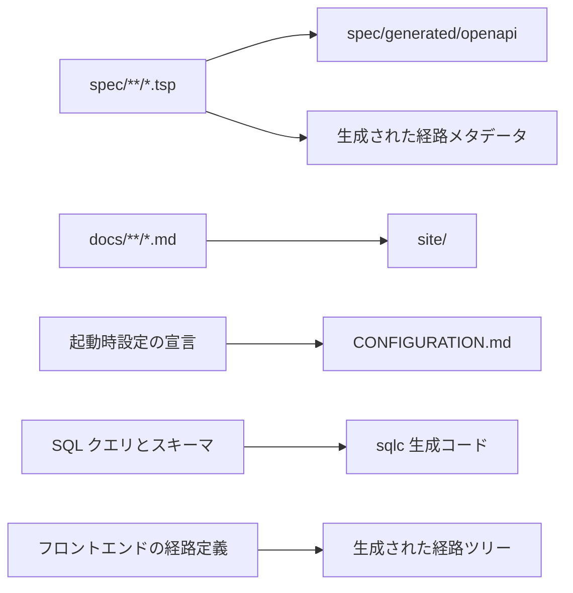

# ローカル開発

## 環境の準備

ツールのバージョンとコマンドは `mise.toml` が一次情報である。ただし **mise 自身は `mise.toml` では導入できない**ので、最初の 1 つだけは外から入れる。

```bash
brew install mise         # macOS
curl https://mise.run | sh # それ以外
```

`mise.toml` は `min_version` で必要な下限を宣言している。これより古い mise は設定を読んだ時点で止まるので、上のいずれかで入れ直す。

続けて、固定したツールとリポジトリの依存を導入する。

```bash
mise install
mise run setup
```

利用できる処理は `mise tasks` で確認する。Go、Bun、Docker、各種生成器を直接呼ばず、対応する `mise run <task>` を使う。

## ローカルスタック

組み込み PostgreSQL、バックエンド API、永続ジョブのワーカー、フロントエンドを含む Docker 不要のローカルスタックを起動する。

```bash
mise run dev
```

初回実行時は組み込み PostgreSQL のバイナリをダウンロードする。開発データは一時的で、スタックの停止時に削除される。ブラウザーで <http://localhost:5173/> を開き、ローカルデモ認証を選択する。`alice` はテナント管理者、`root` はテナント管理者とシステム管理者を兼ね、どちらも開発用パスワードは `demo-password-1234` である。

目的に応じて次のスタックも使える。

```bash
mise run dev-memory
mise run dev-compose
mise run demo-ciba
```

`dev-memory` は永続ジョブとワーカーを使わない最小構成である。`dev-compose` は PostgreSQL、OpenTelemetry Collector、Prometheus、API、フロントエンドゲートウェイを <http://localhost:8080/> で起動する。

## ビルドと検証

```bash
mise run build-go
mise run build-ui
mise run verify
```

Go のバージョン情報は `VERSION`、`GIT_COMMIT`、`BUILD_DATE` から埋め込む。`VERSION` を指定しなければ開発用の `0.0.0-dev` になる。リリース用の値と成果物の扱いは [リリース](release.md) が定める。

依存の準備、局所検証、並列タスクの引数、失敗の収集は[検証の進め方](specification-first-workflow.md#検証の進め方)に従う。
最終検査とブラウザー E2E の範囲は[最終検査の選択](specification-first-workflow.md#最終検査の選択)、Go の `-race` の有無は[通常テストと race 検査](testing.md#go-の通常テストと-race-検査)で判断する。

ゲートごとの所要時間は次で測る。

```bash
mise run time-verify
```

lint のアナライザー別のログが必要なら、`GL_DEBUG=goanalysis/analyze mise run lint-go` を実行する。
コールド実行を測る場合は、先に `mise run clean-lint-cache` を実行する。

work item 着手時の読む節と検証候補は、[作業文脈の導出](task-context.md#起点と追加取得)から取得する。

## 生成の関係

生成物は編集せず、入力を変更して対応するタスクで再生成する。



| 変更した入力 | 再生成 |
| --- | --- |
| TypeSpec または一次情報の Markdown | `mise run render-docs`。TypeSpec の操作を変えたときは `mise run generate-contract` も実行する |
| 起動時設定の宣言 | `mise run generate-config-reference` |
| SQL または sqlc のクエリ | `mise run sqlc-generate` |
| フロントエンドの経路 | `mise run generate-routes` |

生成結果を含むかどうかは各タスクの所有規則に従う。`spec/generated/` と `site/` は追跡しない派生表示であり、リリース用の OpenAPI 互換性ベースラインは [リリース](release.md) でだけ更新する。

## 外部サービスのローカル代替

メール配信の確認には Mailpit などのローカル SMTP サーバーを使い、本番の資格情報を開発環境へ持ち込まない。起動時設定の型、デフォルト値、条件付き要件、機密区分は [設定リファレンス](../../CONFIGURATION.md) を参照する。
