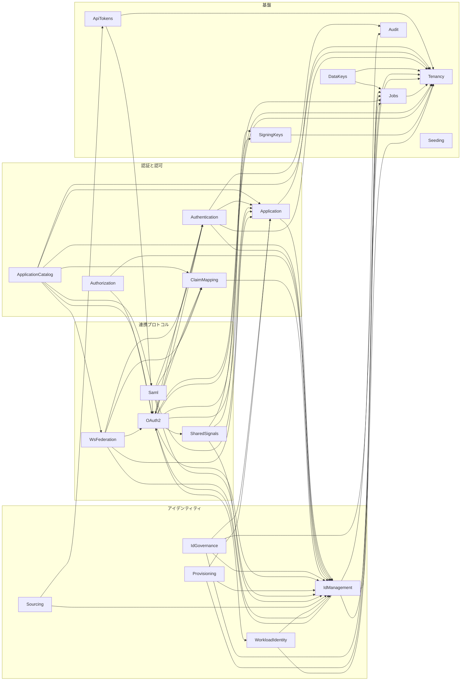

# モジュール設計文書

この文書は、モジュールごとの責務、公開契約、振る舞い、内部の設計を収めるモジュール設計文書の入口である。
システム全体の構造と、モジュールへの割り当ては[全体設計文書](../design/README.md)、製品の目的と要件は[要件文書](../requirements/README.md)で定める。
モジュール設計文書は、全体設計文書からの割り当てと例外だけを書き、同じ内容を書き写さない。

モジュールは、保存表現、正規化、外部プロトコルの変換など、変わりうる設計判断を内部へ隠す単位として設計する。
境界の追加や変更は、要件と不変条件、状態の更新元、公開範囲、変更の波及を[境界を選ぶ判断手順](../design/application/design-guidelines.md#境界を選ぶ判断手順)で比較して決める。

## 読み始める順序

初めて読む場合は、次の順にモジュールの `README.md` を開く。
後のモジュールは前のモジュールの語と状態を前提にする。

| 順序 | モジュール | 先に読む理由 |
| --- | --- | --- |
| 1 | [Tenancy](tenancy/README.md) | すべての業務データはテナントに属し、テナントの境界がほかのモジュールの操作の範囲を決める |
| 2 | [IdManagement](identity-management/README.md) | 認証、認可、連携のどれもが参照する主体（User、Group、Agent）を持つ |
| 3 | [Authentication](authentication/README.md) | ログインとセッションを持ち、連携プロトコルはこのモジュールの認証の結果を使う |
| 4 | [OAuth2](oauth2/README.md) | 代表的な連携プロトコルであり、Application、ClaimMapping、SigningKeys との協調が最もよく現れる |

残りのモジュールは、下の区分と依存の図から、関心のある区分を選んで読む。

## モジュール

**モジュール**は、次の責務表に宣言した責務と、その実装、モジュール設計文書、TypeSpec の対応を一つの単位として呼ぶ名前である。
責務表の一行、`docs/modules/<module>/` のモジュール設計文書、`backend/` の実装のモジュールは一対一に対応し、名前、Go パッケージ、仕様のディレクトリの対応はこの表だけで定める。
表の各列は、境界検査（`mise run check-boundaries`）の入力として次の意味を持つ。

| 列 | 意味 |
| --- | --- |
| モジュール | モジュールの名前と、モジュール設計文書の入口 |
| 公開方式 | `internal`。公開パッケージの列に挙げたパッケージだけを公開する（[公開範囲](../design/application/backend.md#公開範囲と-internal)）。System 行は組み立て地点を表す |
| 公開パッケージ | `internal` のモジュールがほかのモジュールへ公開するパッケージの完全なパス。配下のパッケージは自動的には公開しない |
| Go パッケージ | モジュールに属するパッケージの接頭辞。System 行では組み立て地点の接頭辞 |
| 責務 | モジュールが担う状態と操作 |

公開方式と公開パッケージの判定、組み立て地点と共有ライブラリの扱いは[バックエンド設計](../design/application/backend.md#モジュール間の依存規則)が定める。
モジュールは、扱う対象の性質で次の四つの区分に分けて並べる。

### 基盤

テナント、実行基盤、鍵、監査のように、ほかのモジュールが前提にする状態と仕組みを持つ。System は組み立て地点であり、モジュールの間の依存の図には現れない。

| モジュール | 公開方式 | 公開パッケージ | Go パッケージ | 責務 |
| --- | --- | --- | --- | --- |
| [System](system/README.md) | 組み立て地点 | なし | `backend/cmd`, `backend/shared/http/server_http`, `backend/shared/http/testing_stack`, `backend/shared/testing/fixtures_postgres`, `frontend/` | 起動、機能選択、経路の組み立て、テスト前提の組み立て、健全性、画面 |
| [Tenancy](tenancy/README.md) | `internal` | `backend/tenancy/domain`, `backend/tenancy/ports`, `backend/tenancy/testing_tenant` | `backend/tenancy` | Tenant と realm、テナント設定、属性スキーマ、制御面の管理 |
| [Jobs](jobs/README.md) | `internal` | `backend/jobs/domain`, `backend/jobs/ports` | `backend/jobs` | テナント境界を保つ非同期ジョブ基盤 |
| [Seeding](seeding/README.md) | `internal` | `backend/seeding/domain` | `backend/seeding` | 環境構成のプレビュー、計画、初期データ適用 |
| [SigningKeys](signing-keys/README.md) | `internal` | `backend/signingkeys/domain`, `backend/signingkeys/ports` | `backend/signingkeys` | 用途別署名鍵、証明書、ローテーション、提供元アダプター |
| [DataKeys](data-keys/README.md) | `internal` | なし | `backend/datakeys` | 可逆な秘密情報を保護するテナント別 DEK のライフサイクル |
| [ApiTokens](api-tokens/README.md) | `internal` | `backend/apitoken/domain`, `backend/apitoken/ports` | `backend/apitoken` | 管理 API と SCIM API のテナント単位アクセストークン |
| [Audit](audit/README.md) | `internal` | `backend/audit/ports` | `backend/audit` | 全モジュールの監査イベントを統合する Read Model と保持 |

### アイデンティティ

主体（User、Group、Agent）とそのライフサイクル、外部との取り込みと送り出しを扱う。

| モジュール | 公開方式 | 公開パッケージ | Go パッケージ | 責務 |
| --- | --- | --- | --- | --- |
| [IdManagement](identity-management/README.md) | `internal` | `backend/idmanagement/domain`, `backend/idmanagement/user/domain`, `backend/idmanagement/user/ports`, `backend/idmanagement/group/domain`, `backend/idmanagement/group/ports`, `backend/idmanagement/agent/domain`, `backend/idmanagement/agent/ports` | `backend/idmanagement` | User、Group、Agent、プロフィール、アイデンティティのライフサイクル |
| [IdGovernance](identity-governance/README.md) | `internal` | — | `backend/idgovernance` | LifecycleWorkflow のポリシーとオーケストレーション |
| [Sourcing](sourcing/README.md) | `internal` | `backend/sourcing/scim/ports` | `backend/sourcing` | 上流の権威からの内向きアイデンティティ取り込み |
| [Provisioning](provisioning/README.md) | `internal` | なし | `backend/provisioning` | IdMagic を正とする外向き SCIM プロビジョニング |
| [WorkloadIdentity](workloadidentity/README.md) | `internal` | `backend/workloadidentity/domain` | `backend/workloadidentity` | 外部アテステーションと Agent の対応付け |

### 認証と認可

ログインで本人を確かめ、アプリケーションへの割り当て、細粒度の認可、開示する属性を決める。

| モジュール | 公開方式 | 公開パッケージ | Go パッケージ | 責務 |
| --- | --- | --- | --- | --- |
| [Authentication](authentication/README.md) | `internal` | `backend/authentication/domain`, `backend/authentication/mfa/domain`, `backend/authentication/password/domain`, `backend/authentication/password/ports`, `backend/authentication/recovery/domain`, `backend/authentication/recovery/ports`, `backend/authentication/session/domain`, `backend/authentication/session/ports`, `backend/authentication/signin/ports`, `backend/authentication/totp/domain`, `backend/authentication/totp/ports`, `backend/authentication/trusteddevice/domain`, `backend/authentication/trusteddevice/ports`, `backend/authentication/webauthn/domain`, `backend/authentication/webauthn/ports` | `backend/authentication` | 資格情報、MFA、ログインセッション、ステップアップ、認証イベント |
| [Authorization](authorization/README.md) | `internal` | なし | `backend/authorization` | 細粒度認可モデル、関係タプル、グラフ評価、整合トークン |
| [Application](application/README.md) | `internal` | `backend/application/domain`, `backend/application/ports`, `backend/application/usecases` | `backend/application` | Application、プロトコルのバインディング、割り当て、表示分類の状態と更新、サインインポリシーとアクセス判定 |
| [ApplicationCatalog](application-catalog/README.md) | `internal` | なし | `backend/applicationcatalog` | Application と各プロトコルの管理の編成、管理とポータルの HTTP、表示用の変換 |
| [ClaimMapping](claim-mapping/README.md) | `internal` | `backend/claimmapping/domain`, `backend/claimmapping/ports` | `backend/claimmapping` | プロトコル非依存のクレーム開示ポリシーとマッピング |

### 連携プロトコル

外部のアプリケーションやサービスと、標準のプロトコルで連携する。

| モジュール | 公開方式 | 公開パッケージ | Go パッケージ | 責務 |
| --- | --- | --- | --- | --- |
| [OAuth2](oauth2/README.md) | `internal` | `backend/oauth2/domain`, `backend/oauth2/ports`, `backend/oauth2/client/ports`, `backend/oauth2/consent/ports`, `backend/oauth2/logout/ports` | `backend/oauth2` | OAuth 2.0 と OIDC のプロトコル、クライアント、同意、トークン |
| [Saml](saml/README.md) | `internal` | `backend/saml/domain`, `backend/saml/ports` | `backend/saml` | SAML 2.0 IdP、SP の信頼、SSO、SLO、メタデータ |
| [WsFederation](ws-federation/README.md) | `internal` | `backend/wsfederation/domain`, `backend/wsfederation/ports` | `backend/wsfederation` | WS-Federation、WS-Trust、メタデータ、RP の信頼 |
| [SharedSignals](sharedsignals/README.md) | `internal` | `backend/sharedsignals/domain`, `backend/sharedsignals/ports` | `backend/sharedsignals` | SSF、SET、CAEP による継続的アクセス評価と失効 |

### モジュールの間の依存

次の図は、本番の Go ソースの import から求めたモジュールの間の依存である。
矢印は、元のモジュールが先のモジュールの公開パッケージを使うことを表す。
図は `mise run generate-module-dependencies` が生成し、手で書き換えない。
コードと図が食い違うと、リポジトリの検査が拒否する。

<!-- generated:module-dependencies:start -->

<!-- generated:module-dependencies:end -->

ドメインイベントによる協調は、組み立て地点の配信点を通るので import を生まず、この図に現れない。
イベントの語彙は[モジュール間イベント](../design/application/backend.md#モジュール間イベント)、複数のモジュールにまたがる保証は[横断シナリオ](scenarios.feature.md)が定める。

## モジュール設計文書の構成

### 仕様と設計

モジュール設計文書の文には、仕様と設計の二種類がある。
**仕様**は、検証の対象になる規範である。
機能仕様の要件（`REQ-*`）、受け入れ例、横断シナリオ、`standards.md` の準拠と逸脱、品質要件の割り当て、TypeSpec の契約がこれにあたり、テストと検査がこれを参照する。
**設計**は、仕様を満たす構造、仕組み、判断の説明である。

二つは文の性質による区別であり、ファイルの区別ではない。
たとえば機能仕様は、要件の後ろの節「実現方式」にその機能に閉じた設計を書く。
ファイルは、何についての文書か（モジュール全体、設計領域、機能）で分ける。

モジュールの内部は、開発者と運用者にとって最も素直な形をデフォルトとし、文書に書かない。
そうでない構造を選んだときだけ、その構造と理由を書く（[共通設計の適用範囲](../design/README.md#共通設計の適用範囲)）。
外から観測できる振る舞いは、このデフォルトによらず、機能仕様と TypeSpec が漏れなく定める。

### 適用範囲ごとの置き場所

| 適用範囲 | 置き場所 |
| --- | --- |
| すべてのモジュール | `docs/modules/` の直下 |
| 一つのモジュール | `docs/modules/<module>/` の直下 |
| 一つの機能 | `docs/modules/<module>/features/` |

| 文書 | 内容 |
| --- | --- |
| [共通用語集](glossary.md) | すべてのモジュールが同じ意味で使う語 |
| [横断シナリオ](scenarios.feature.md) | 複数のモジュールの協調による保証と、複数のモジュールへ共通に適用する保証 |

### 一つのモジュールの文書

各モジュールには `README.md` を置く。
その他の文書は、書くべき内容があるときに置く。
並びは、全体設計文書と同じく、概要、語彙と外部規範、品質、設計領域、設計の記録の順である。

| 文書 | 対象 | 内容 |
| --- | --- | --- |
| `README.md` | モジュール全体 | 外から見た概要と道案内。責務と境界、主な流れ、設計の要点、機能一覧と、最後の節「文書」の索引 |
| `glossary.md` | モジュール全体 | モジュール固有の語義と、全体の語を狭めた定義 |
| `standards.md` | モジュール全体 | 採用する外部規範と逸脱 |
| `quality.md` | モジュール全体 | システムから割り当てられた品質要件と固有の値 |
| `data.md`、`security.md` など | 設計領域 | 全体設計文書と同じ設計領域ごとの、このモジュールに固有の設計。`data.md` の「集約」が Aggregate と値オブジェクトを定める。アーキテクチャ設計の文書は持たない |
| `decisions.md` | 設計の記録 | 代替案を比べた、現在有効な判断と見直し条件 |
| `risks.md` | 設計の記録 | 既知の欠陥、技術的負債、受容したリスク |
| `features/<feature>.md` | 機能 | 一つの機能の要件、操作、状態遷移。最後の節「実現方式」に、その機能に閉じた設計を書く |
| `features/<feature>.<chapter>.md` | 機能 | 長くなった機能仕様の章 |
| `features/<feature>.feature.md` | 機能 | 要件に付ける任意の受け入れ例 |

モジュールの直下には、この表の名前の文書と `features/` だけを置く。
複数の機能が共有する仕組みは、それを担う機能の「実現方式」（CSV の転送など）か、最も関係の深い設計領域の文書に書く。
関係の深い機能は、`README.md` の機能の表で機能群として並べ、機能群のためのディレクトリは置かない。

モデル、API、認証機構の契約は `spec/modules/<module>/` の TypeSpec が定める。
散文の側に同じ契約を書かない。
仕様の記述規則は[仕様フォーマット](../formats/specification-format.md)、設計の記述規則は[設計フォーマット](../formats/design-format.md)、配置は[文書ガイド](../formats/documentation-guide.md#配置)が定める。
