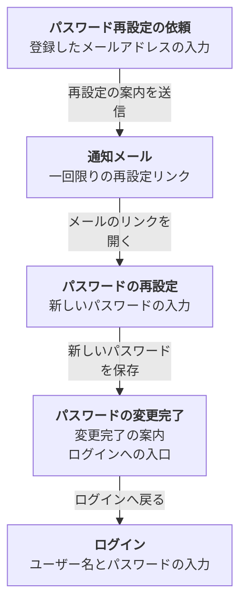

# Authentication のページ

この文書は、Authentication が主担当となるページの設計を示す。

> 表示確認用の途中プレビュー。全ページの棚卸しと検証は継続中である。

TypeSpec の UI 宣言から `mise run generate-ui-pages` で生成する。手で編集しない。

[Authentication のモジュール設計](../README.md) / [UI 全体の索引](../../../design/application/pages/README.md)

## 主な利用手順

枠は利用者に見えるページや表示、矢印は次へ進む操作を示す。破線は戻り道、枠の破線はシステム外の表示である。

### メールからパスワードを再設定する

再設定の案内を受け取り、新しいパスワードを設定してログインへ戻る。

- 通知メールは IdMagic の外で利用者が読む表示として区別する。
- 期限切れや使用済みリンクの扱いは、パスワード再設定ページの操作表に示す。

ページの詳細：[ログイン](login.md)、[パスワード再設定の依頼](forgot-password.md)、[パスワードの再設定](reset-password.md)

## サインイン

| ページ | URL | 目的 |
| --- | --- | --- |
| [ログイン](login.md) | `/login` | 資格情報または既存の認証手段で認証を開始する |
| [二要素認証](totp.md) | `/totp` | 利用可能な認証手段で第二要素を確認する |
| [認可フロー内の MFA 登録](mfa-enrollment.md) | `/mfa-enrollment` | ログインを継続する前に TOTP を登録する |

## アカウント復旧

| ページ | URL | 目的 |
| --- | --- | --- |
| [パスワード再設定の依頼](forgot-password.md) | `/forgot_password` | 登録したメールアドレスへ再設定の案内を依頼する |
| [パスワードの再設定](reset-password.md) | `/reset_password` | メールのリンクから新しいパスワードを設定する |

## セキュリティ

| ページ | URL | 目的 |
| --- | --- | --- |
| [パスワード変更](change-password.md) | `/account/password` | 現在のパスワードを確認して新しいパスワードへ変更する |
| [本人のセキュリティ設定](account-security.md) | `/account/security` | 認証手段、回復コード、記憶済みデバイスと通知を管理する |
| [ログイン履歴とセッション](account-activity.md) | `/account/activity` | 本人のログイン履歴を確認し不要なセッションを失効させる |
