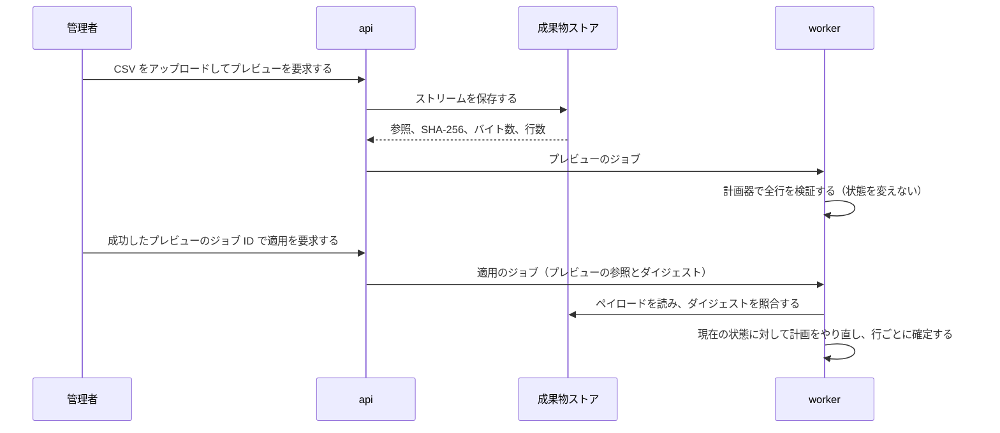

# CSV の転送

## 概要

この文書は、User と Group の CSV のインポートとエクスポートが共有する、ファイルとセルの読み書きの規則の仕様である。

| 項目 | 内容 |
| --- | --- |
| 責務 | 見出しと行の読み取り、転送ポリシーの上限、セルの数式の保護、属性値のセルの字句形、成果物の保持 |
| 行為者 | 管理者（CSV のインポートとエクスポート）、Batch の保持期限の削除（`retention-sweep`） |
| 扱わないもの | User の列と行の計画は[ユーザー CSV](user-csv.md)が、Group とメンバーシップの列と行の計画は[グループ CSV](group-csv.md)が、エクスポートのジョブは[データエクスポート](data-export.md)が扱う |

## 操作

### 見出しと行の読み取り

#### REQ-IDMANAGEMENT-034 CSV の見出しは機械キーと完全に一致する名前だけを受け付ける

- CSV を読むとき、IdManagement は、見出しの先頭の UTF-8 の BOM を取り除いてから照合する。
- CSV を読むとき、IdManagement は、見出しの各列名を、大文字と小文字、前後の空白を含めて、種別が受け付ける機械キーと完全一致で照合する。
- 機械キーと一致しない列名を含むファイルを受けた場合、IdManagement は、`invalid_header` で拒否する。
- `password`、`password_hash`、`mfa_secret`、`token`、`recovery_code` を見出しに含むファイルを受けた場合、IdManagement は、種別によらず `invalid_header` で拒否する。
- 見出しの行もない空のファイルを受けた場合、IdManagement は、`invalid_csv` で拒否する。
- 見出しでファイルを拒否した場合、IdManagement は、どの行も計画しない。

#### REQ-IDMANAGEMENT-035 列の数が見出しと異なる行は、その行だけを拒否する

- 列の数が見出しの列の数と異なる行を読んだ場合、IdManagement は、その行を `invalid_column_count` で `rejected` とし、続く行の解析と計画を続ける。
- 転送ポリシーの上限を超えたか、RFC 4180 として読めない場合、IdManagement は、その位置でファイル全体の解析を止める。

#### REQ-IDMANAGEMENT-037 CSV の転送ポリシーの上限は、上限と等しい値を受け付け、超えた値を拒否する

- CSV を読み書きするとき、IdManagement は、次の表の上限を、一つの成果物に適用する。

| 上限 | デフォルト値 |
| --- | --- |
| データ行の数 | 100,000 行 |
| 成果物の大きさ | 64 MiB |
| 一つの項目の大きさ | 64 KiB |

- データ行の数を数えるとき、IdManagement は、見出しの行を除く。
- 上限と等しい値を受けたとき、IdManagement は、その値を受け付ける。
- 上限を超えた値を受けた場合、IdManagement は、拒否する。
- IdManagement は、転送ポリシーの上限でテナントの User や Group の件数を制限しない。

### セルの読み書き

#### REQ-IDMANAGEMENT-036 先頭のアポストロフィーは、数式の保護として付けたものだけを取り除く

- インポートがアポストロフィーで始まり、その次の文字がアポストロフィーまたは `=`、`+`、`-`、`@`、タブ、CR、LF のセルを読んだとき、IdManagement は、先頭の一文字を取り除く。
- インポートがそれ以外のアポストロフィーで始まるセルを読んだとき、IdManagement は、そのまま読む。

#### REQ-IDMANAGEMENT-038 属性値のセルは型ごとの正規の字句形だけを受け付ける

- 属性値のセルを読むとき、IdManagement は、次の表の型ごとの字句形だけを受け付ける。

| 型 | 受け付ける字句形 |
| --- | --- |
| `string` | 任意の文字列 |
| `date` | `YYYY-MM-DD` の暦日 |
| `number` | 最短の十進表記。`1.0` や `01` は受け付けない |
| `boolean` | `true` または `false` |
| `string_array` | 空白を含まない JSON の文字列配列 |

- 属性値をエクスポートするとき、IdManagement は、表と同じ字句形で書き出す。
- IdManagement は、User の CSV と Group の CSV に同じ字句形を使う。
- 任意の属性の空のセルを読んだとき、IdManagement は、その属性を消す。
- 型の字句形に合わないセルを読んだ場合、IdManagement は、拒否する。
- 必須の属性の空のセルを読んだ場合、IdManagement は、拒否する。

### 成果物の保持

#### REQ-IDMANAGEMENT-080 CSV の成果物は、作成から 30 日を過ぎると消す

- 保持期限の削除を実行したとき、IdManagement は、作成の時刻が実行の時刻の 30 日前より前の CSV の成果物（エクスポートのファイル、インポートのペイロード、行のエラーのページ）を、分割したペイロードごと消す。
- 保持期限の削除を実行したとき、IdManagement は、作成の時刻が実行の時刻の 30 日前ちょうどか、それより後の成果物を消さない。
- **判断**：エクスポートの成果物は完了の時点で作るので、作成から 30 日で消すと、エクスポートの保持期限（REQ-IDMANAGEMENT-079）と同じ時点で消える。インポートのペイロードは、プレビューのジョブの記録と同じ期間だけ残る。
- **例**：EX-IDMANAGEMENT-080-01

## 実現方式

User と Group の CSV のエクスポートとインポートが共有する仕組みを扱う。
CSV は二つ目のプロビジョニングの権威ではなく、IdManagement が備える部分更新の窓口である。
転送の上限と、往復で守る性質は、上の要件が定める。

### アーキテクチャ

#### 共有するものと、種別ごとに分けるもの

| 部品 | 共有するか | 理由 |
| --- | --- | --- |
| 転送ポリシー、解析器と直列化器、可逆なセル変換、不変な成果物ストア | User と Group で共有する | 種別ごとに違うのは、どの機械キーを受理するかだけである。解析器はその判定だけを受け取る |
| 列の語彙 | 種別ごとに分ける | 組み込みの書き込み可能列、読み取り専用列、禁止列は、種別ごとに閉じた集合である |
| 計画器 | 種別ごとに分ける | 不変な項目、外部の権威の規則、ライフサイクルの操作は Aggregate ごとの不変条件であり、一つに一般化すると両方の規則が読めなくなる |

列の語彙と可逆なセル変換はドメインに置く。
エクスポートとインポートは、HTTP のラベルや UI のロケールに依存せず、一つの定義を共有する。
User のテナント定義の列は、実効的な属性スキーマを解決した後にだけ `custom:<key>` として加える。
これにより、解析を決定的に保ちながら、テナントのスキーマを CSV 処理とは独立して変えられる。

#### 解析と変換

| 性質 | 仕組み |
| --- | --- |
| 列がないことと、空の列を区別する | 解析器は列の有無とセルの内容を別々に保持する。列がなければ項目を変えず、空の列は項目を消す意味を持ち得る |
| 不正なヘッダーを早く拒否する | どの行も計画する前に、未知のヘッダー、重複するヘッダー、シークレットを含むヘッダーを拒否する |
| 表計算の数式として解釈されない | 危険な先頭文字と既存の先頭アポストロフィーに、可逆な形で接頭辞を付ける。レコードの引用は RFC 4180 の変換器に任せる |
| 往復で値が変わらない | カンマ、引用符、複数行の値を含めて `decode(encode(value)) == value` が成り立つ。報告専用のエクスポートで使う、情報を失うアポストロフィーのエスケープは受け付けない |

#### プレビューと適用

| 段 | 保証すること | 仕組み |
| --- | --- | --- |
| プレビュー | CSV を受け取るのは一度だけである | テナント単位の不変な成果物ストアがストリームを受け取る。ジョブのパラメーターと結果は、メタデータと要約だけを保存し、CSV の本文を含まない |
| プレビュー | 状態を変えない | 計画器は、既存の Aggregate を不変な ID、次にテナント内で一意な名前（User はユーザー名、Group は `name`）で解決し、型付きの値と行の間の衝突を検証して、行操作を生成するだけである |
| 適用 | プレビューしたペイロードだけを実行する | 成功したプレビューのジョブ ID だけを受け付け、別の CSV やクライアントが示すダイジェストは受け付けない。SHA-256 は実行対象をプレビュー時のペイロードに束縛する内部の完全性検査であり、署名ではなく、認可を置き換えない |
| 適用 | 同時の変更を見逃さない | プレビュー時の計画を実行せず、現在の状態に対して同じ計画器をもう一度実行する |
| 適用 | 行の失敗が他の行を巻き戻さない | 受理した各行は、Aggregate の項目、直接付与するロール、従属する記録、監査イベントを一つのトランザクションで確定する。失敗した行は部分的な変更を残さない |

判断：[CSV の適用をプレビューで保存したペイロードに束縛する](../decisions.md#csv-の適用をプレビューで保存したペイロードに束縛する)。

#### 行のエラーの報告

大量の行のエラーは、成果物ストアの固定件数のページへ直列化し、リソース固有のエラーテーブルやジョブの JSON に置かない。
結果の API は、管理 API のテナントとクエリに束縛した署名付きカーソル、`limit`、RFC 8288 の `Link`、`Pagination-*` ヘッダーを使う。
エラーの通し番号はページとページ内の位置へ直接対応するので、深い位置を読むときに先行するエラーを走査しない。

#### 外部の権威の保護

取り込み元の所有権ガードは、既存の User または Group が外部の権威の管理下にあるかを返す。
所有権を確認できない場合と、確認に失敗した場合は、外部の管理下として扱って行を拒否する。
CSV という便宜的な経路が、より強い上流の権威を暗黙に上書きしないためである。

### 委ねる設計

- 設計判断：モジュールの[重要な設計判断](../decisions.md)に従う
- データ設計：成果物ストアはモジュールの[データ](../data.md)が扱う
- セキュリティ設計：シークレットの列の拒否と数式の保護は、上の「解析と変換」が扱う
- 信頼性設計：モジュールの[信頼性](../reliability.md)に従う
- 性能設計：[IdManagement の性能](../performance.md)
