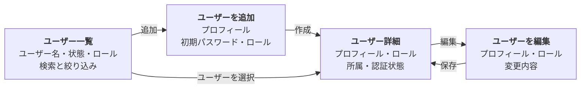
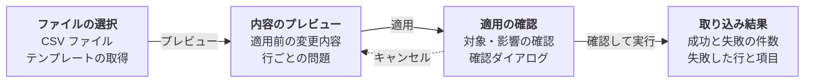

# IdManagement のページ

この文書は、IdManagement が主担当となるページの設計を示す。

> 表示確認用の途中プレビュー。全ページの棚卸しと検証は継続中である。

TypeSpec の UI 宣言から `mise run generate-ui-pages` で生成する。手で編集しない。

[IdManagement のモジュール設計](../README.md) / [UI 全体の索引](../../../design/application/pages/README.md)

## 主な利用手順

枠は利用者に見えるページや表示、矢印は次へ進む操作を示す。破線は戻り道、枠の破線はシステム外の表示である。

### ユーザーを作成して編集する

ユーザーを作成し、プロフィールとロールを確認して変更する。

- 既存のユーザーは一覧から詳細へ進み、同じ編集の手順を使う。
- 入力不備、権限不足、保存の失敗は各ページの操作表に示す。

ページの詳細：[ユーザー一覧](admin-users.md)、[ユーザー詳細](admin-user-detail.md)、[ユーザーを追加](admin-user-create.md)、[ユーザーを編集](admin-user-edit.md)

### CSV を確認して取り込む

取り込み前に内容を確認し、確認後にだけ変更を適用する。

- 四つの表示は同じ CSV インポートページ内で切り替わる。
- 結果では成功と失敗の件数、失敗した行と項目を確認できる。

ページの詳細：[ユーザーの CSV インポート](admin-user-import.md)

## ユーザー管理

| ページ | URL | 目的 |
| --- | --- | --- |
| [ユーザー一覧](admin-users.md) | `/admin/users` | ユーザーを検索し、対象の確認と管理の入口を示す |
| [ユーザー詳細](admin-user-detail.md) | `/admin/users/$id` | 現在のプロフィール、権限、所属と認証の状態を確認する |
| [ユーザーを追加](admin-user-create.md) | `/admin/users/new` | 初期資格情報とプロフィールを指定してユーザーを作成する |
| [ユーザーを編集](admin-user-edit.md) | `/admin/users/$id/edit` | プロフィール、ロールとカスタム属性を一回の保存で変更する |
| [ユーザーの CSV インポート](admin-user-import.md) | `/admin/users/import` | CSV をプレビューしてから確認を経て適用し、行ごとの結果を確認する |

## プロフィール

| ページ | URL | 目的 |
| --- | --- | --- |
| [本人のプロフィール](account-profile.md) | `/account/profile` | 本人の基本情報と公開された属性を確認する |
| [本人のプロフィールを編集](account-profile-edit.md) | `/account/profile/edit` | 本人に編集が許可された基本情報と属性を更新する |
| [本人のメールアドレス](account-emails.md) | `/account/emails` | 現在の確認状態を確認し、新しいアドレスの確認を依頼する |
| [メールアドレスの確認](email-verify.md) | `/account/email/verify` | メールに含まれるトークンで変更を確認する |
| [本人のデータ](account-data.md) | `/account/data` | 本人のデータを JSON として取得する |
