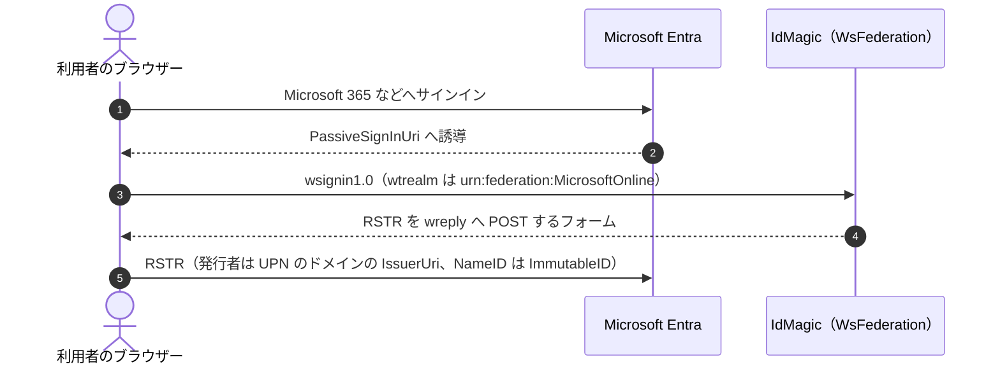
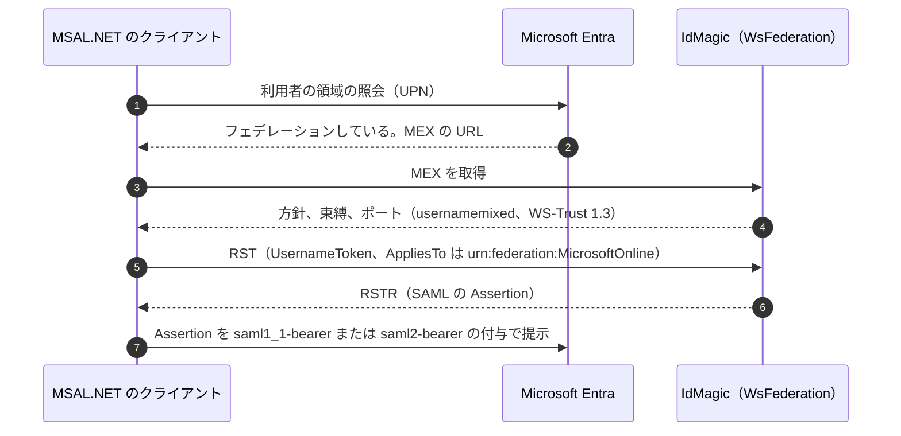

# WsFederation の標準仕様

## 標準と製品の関係

WsFederation の相互運用は、一つの標準ではなく、WS-* の複数の標準と、Microsoft Entra、Microsoft Graph、MSAL.NET の要件の組み合わせで成り立つ。
この節は、利用者のどの要求がどの標準とどの入口に当たるかを示す。
製品が守る義務は、この節ではなく下の各標準の行が定める。

### 標準の役割

| 役割 | 標準または製品の要件 | WsFederation での扱い |
| --- | --- | --- |
| ブラウザーのサインインとサインアウト | [WS-Federation 1.2](#web-services-federation-language-ws-federation-version-12) の受動的な要求（`wsignin1.0`、`wsignout1.0`） | `<発行者>/wsfed` で要求を受け、署名した Assertion を含む RSTR を、登録した `wreply` へ自動で POST するフォームで返す |
| リッチクライアントのトークンの取得 | [WS-Trust 1.3](#ws-trust-13) の Issue、[UsernameToken Profile](#web-services-security-usernametoken-profile-111)、[WS-Addressing](#web-services-addressing-10---core) | `<発行者>/trust/usernamemixed` で SOAP の RST を受け、利用者名とパスワードを確かめて RSTR を返す |
| 入口と証明書の探索 | WS-Federation のフェデレーションメタデータと、WS-Trust の MEX | `<発行者>/federationmetadata/2007-06/federationmetadata.xml` と `<発行者>/trust/mex` で公開する |
| トークン | SAML 1.1 または SAML 2.0 の Assertion | 受動的な要求と能動的な要求のどちらでも RSTR に入れる。RP の設定がなければ SAML 1.1 とする |
| Entra のドメインフェデレーション | [Entra の IdP の要件](#microsoft-entra-の-saml-20-と-ws-federation-の-idp-の要件)、[複数のドメイン](#microsoft-entra-connect-の複数のドメインのフェデレーション)、[信頼のクレームの規則](#microsoft-entra-connect-の-entra-id-の信頼のクレームの規則)、[sourceAnchor](#microsoft-entra-connect-の-sourceanchor) | Entra を `urn:federation:MicrosoftOnline` の RP として扱い、利用者の UPN のドメインの IssuerUri を発行者に、sourceAnchor の値を ImmutableID にして発行する |
| Entra への登録 | [Microsoft Graph の internalDomainFederation](#microsoft-graph-のドメインのフェデレーションの設定internaldomainfederation) | 管理 API の構成の結果で、Graph に渡す入口と証明書を案内する |
| リッチクライアント | [MSAL.NET の WS-Trust](#msalnet-の-ws-trust-のクライアント) | MSAL が MEX から選べる形で usernamemixed を公開し、MSAL が組み立てる RST を受け付ける |

`<発行者>` はテナントの発行者で、デフォルトテナントでは `/realms/default` である。

### Entra の設定値と入口

Entra は、ドメインのフェデレーションの設定値で IdMagic の入口を知る。
管理 API の構成の結果は、次の値を Microsoft Graph PowerShell の名前で返す。

| Graph の設定値 | Graph が定める用途 | WsFederation が案内する値 |
| --- | --- | --- |
| `PassiveSignInUri` | Web のクライアントが Entra のサービスへサインインするときの誘導先 | `<発行者>/wsfed` |
| `ActiveSignInUri` | 能動的なクライアントが認証に使うエンドポイント | `<発行者>/trust/usernamemixed` |
| `MetadataExchangeUri` | リッチクライアントが認証に使う MEX のエンドポイント | `<発行者>/trust/mex` |
| `SignOutUri` | Entra のサービスからサインアウトしたときの誘導先 | `<発行者>/wsfed?wa=wsignout1.0` |
| `IssuerUri` | フェデレーションサーバーの発行者 | ドメインごとの IssuerUri（省略時は `urn:idmagic:entra:<ドメイン>`） |
| `SigningCertificate` | Microsoft のアイデンティティ基盤へ渡すトークンの署名に使う現在の証明書 | メタデータに載せた現在の XML 署名の証明書の base64 |
| `PreferredAuthenticationProtocol` | 優先する認証プロトコル | `wsFed` |

### Entra を介したサインインの流れ

ブラウザーの利用者は受動的な要求で、MSAL を使うリッチクライアントは能動的な要求で、同じ Assertion を受け取る。
どちらの流れでも、Entra は Assertion の署名を `SigningCertificate` で、発行者を `IssuerUri` で確かめ、ImmutableID で Entra の利用者に結び付ける。

MSAL の手順は、MSAL.NET の `UsernamePasswordRequest` と `CommonNonInteractiveHandler` が、利用者の領域の照会、MEX からの usernamemixed の選択、Assertion の型による付与の型の選択の順に実装している。

## Web Services Federation Language (WS-Federation) Version 1.2

1.2 — https://docs.oasis-open.org/wsfed/federation/v1.2/ws-federation.html

| ID | Adoption | Strength | Statement |
|---|---|---|---|
| WSFED-PASSIVE-SIGN-IN | required | MUST | wsignin1.0 で登録済み wtrealm と許可済み wreply にだけトークンを返す |
| WSFED-SILENT-SIGN-IN | excluded | MAY | silent sign-in / prompt=none 相当の無音認証 |

## WS-Trust 1.3

1.3 — https://docs.oasis-open.org/ws-sx/ws-trust/v1.3/ws-trust.html

| ID | Adoption | Strength | Statement |
|---|---|---|---|
| WSTRUST13-ISSUE-BEARER | required | MUST | Issue 要求に対して Bearer SAML assertion を RSTR で返す |
| WSTRUST13-WINDOWS-TRANSPORT | excluded | MAY | WindowsTransport / Kerberos based active profile |

## Web Services Security UsernameToken Profile 1.1.1

1.1.1 — https://docs.oasis-open.org/wss-m/wss/v1.1.1/os/wss-UsernameTokenProfile-v1.1.1-os.html

| ID | Adoption | Strength | Statement |
|---|---|---|---|
| WSS-USERNAME-TOKEN-PASSWORD | required | MUST | WS-Trust active STS は UsernameToken username/password を認証する |

## Web Services Addressing 1.0 - Core

1.0 — https://www.w3.org/TR/ws-addr-core/

| ID | Adoption | Strength | Statement |
|---|---|---|---|
| WSADDRESSING-MESSAGE-ID-TO-ACTION | required | MUST | MessageID はリプレイ防止のために検証し、To は能動的 STS のエンドポイント、Action は WS-Trust 1.3 の Issue の要求（`http://docs.oasis-open.org/ws-sx/ws-trust/200512/RST/Issue`）として検証する |

## Microsoft Entra の SAML 2.0 と WS-Federation の IdP の要件

2026-10-23 参照 — https://learn.microsoft.com/en-us/entra/identity/hybrid/connect/how-to-connect-fed-saml-idp

| ID | Adoption | Strength | Statement |
|---|---|---|---|
| ENTRA-FED-REALM | required | MUST | Entra の定型設定の RP は、`wtrealm`、`AppliesTo`、audience を `urn:federation:MicrosoftOnline` とし、Entra の受動的な要求と RST に応じる |
| ENTRA-FED-ISSUER | required | MUST | Entra の RP へ発行する Assertion の発行者を、利用者の UPN のドメインに構成した IssuerUri にする |
| ENTRA-FED-NAMEID | required | MUST | Entra の RP へ発行する Assertion の永続的な NameID に ImmutableID を、UPN のクレームに UPN を入れる |

## Microsoft Entra Connect の複数のドメインのフェデレーション

2026-10-23 参照 — https://learn.microsoft.com/en-us/entra/identity/hybrid/connect/how-to-connect-install-multiple-domains

| ID | Adoption | Strength | Statement |
|---|---|---|---|
| ENTRA-MULTIDOMAIN-SUBDOMAIN | required | MUST | 構成したドメインのサブドメインの UPN の利用者には、最も長く一致する親のドメインの IssuerUri で発行する |
| ENTRA-MULTIDOMAIN-ISSUER-URI | required | MUST NOT | 同じ IssuerUri を二つのドメインに構成しない |

## Microsoft Entra Connect の Entra ID の信頼のクレームの規則

2026-10-23 参照 — https://learn.microsoft.com/en-us/entra/identity/hybrid/connect/how-to-connect-azure-ad-trust

| ID | Adoption | Strength | Statement |
|---|---|---|---|
| ENTRA-CLAIMS-USER | required | MUST | Entra の RP へ発行する利用者のトークンに、UPN、ImmutableID（`http://schemas.microsoft.com/LiveID/Federation/2008/05/ImmutableID`）、nameidentifier のクレームを含める |

## Microsoft Entra Connect の sourceAnchor

2026-10-23 参照 — https://learn.microsoft.com/en-us/entra/identity/hybrid/connect/plan-connect-design-concepts

| ID | Adoption | Strength | Statement |
|---|---|---|---|
| ENTRA-SOURCEANCHOR-VERBATIM | required | MUST | sourceAnchor の属性の値を、大文字と小文字を含めて変えずに ImmutableID として発行する。objectGUID のような文字列でない値の base64 への符号化は、値を取り込む側が行う |
| ENTRA-SOURCEANCHOR-AT-SIGN | required | MUST NOT | `@` を含む sourceAnchor の値を ImmutableID として発行しない |

## Microsoft Graph のドメインのフェデレーションの設定（internalDomainFederation）

2026-10-23 参照 — https://learn.microsoft.com/en-us/graph/api/resources/internaldomainfederation

| ID | Adoption | Strength | Statement |
|---|---|---|---|
| ENTRA-GRAPH-PASSIVE-PROTOCOL | required | MUST | Entra の構成の結果で、`PreferredAuthenticationProtocol` に `wsFed` を案内する。明示しなければ受動的なフローが動かないからである |
| ENTRA-GRAPH-SIGNING-CERTIFICATE | required | MUST | Entra の構成の結果で、`SigningCertificate` に、メタデータに載せた現在の有効な XML 署名の証明書の base64 を案内する |
| ENTRA-GRAPH-SIGN-OUT | required | MUST | Entra の構成の結果で、`SignOutUri` に `wsignout1.0` を受ける受動的なエンドポイントを案内する |

## MSAL.NET の WS-Trust のクライアント

main（`src/client/Microsoft.Identity.Client/WsTrust`）— https://github.com/AzureAD/microsoft-authentication-library-for-dotnet/tree/main/src/client/Microsoft.Identity.Client/WsTrust

| ID | Adoption | Strength | Statement |
|---|---|---|---|
| MSAL-WSTRUST-RST | required | MUST | MSAL が組み立てる WS-Trust 1.3 の UsernameToken の RST（Action が `.../RST/Issue`、小数秒付きの Timestamp、`ReplyTo` を含む）を受け付ける |
| MSAL-WSTRUST-MEX | required | MUST | MEX の方針、束縛、ポートを、MSAL が方針から束縛、束縛からポートの順にたどって usernamemixed を WS-Trust 1.3 として選べる形で公開する。MSAL は `UsernameToken` を WS-SecurityPolicy 2005/07 の名前空間でだけ探すので、方針をその名前空間で書く |
